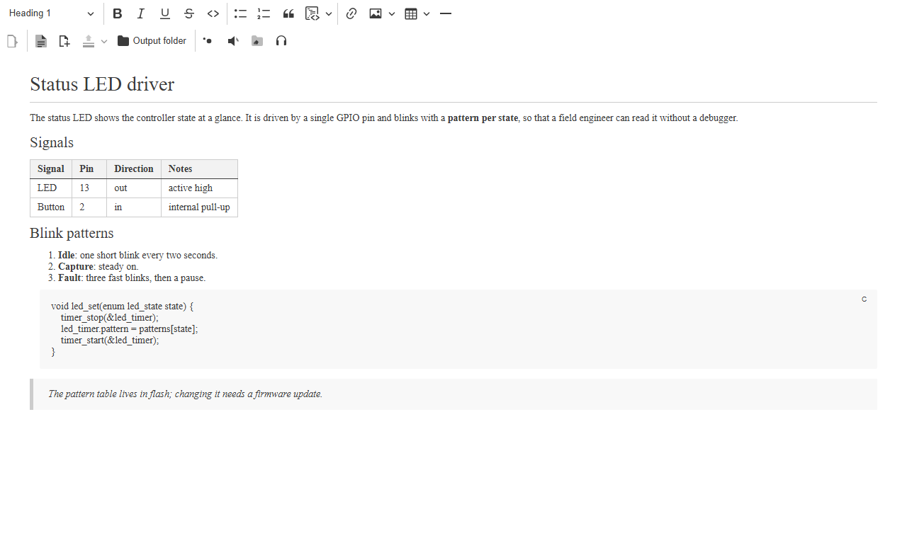
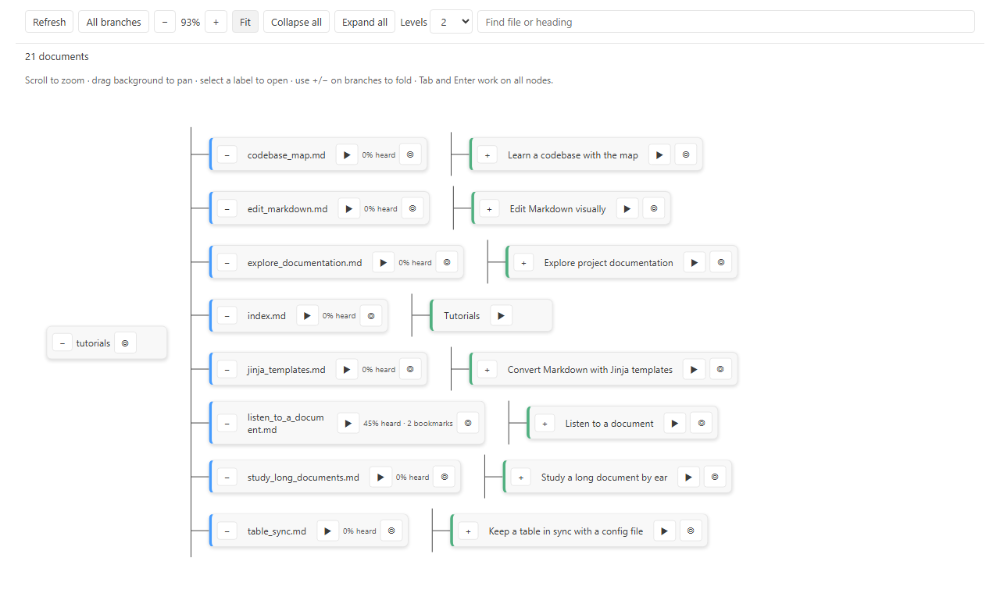
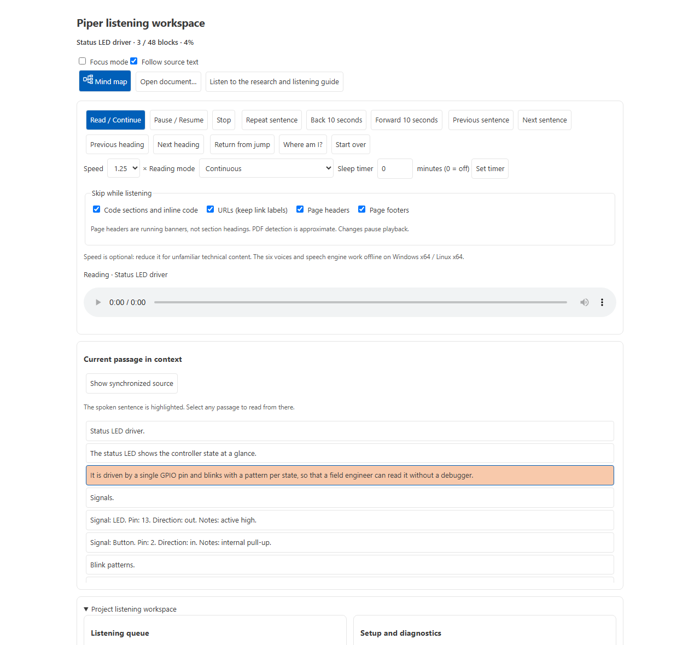

# Markdown Editor and Listening Workspace

[](https://github.com/xsession/vscode-markdown-wysiwyg/actions/workflows/validate.yml)
[](LICENSE.txt)
[](https://code.visualstudio.com/)

A VS Code extension for engineers who write, read and maintain technical
documentation. Everything runs locally: no document text, source code or
speech is sent to a service.

- **WYSIWYG Markdown editing** with tables, images, code blocks and rich-text
  paste. Toggle to plain text with Ctrl+Shift+E.
- **Offline listening** to Markdown and nine other formats (PDF, Word, EPUB,
  HTML, …) with a bundled Piper engine and six English and Hungarian voices.
  You can navigate by sentence and heading, bookmark, and resume where you
  stopped.
- **Documentation explorer**: a tree and an interactive mind map of every
  document in the workspace, with listening queues and guided tours.
- **Codebase map**: source code drawn as a landscape (folders are islands,
  files are hills, imports are roads), with routes between files, a landmark
  walk and a CPU-profile overlay.
- **Jinja conversion templates**: turn Markdown into YAML, JSON, TOML, XML,
  CSV, HTML and more, infer templates from examples, and keep both sides in
  sync live.
- **Table synchronization**: bind a Markdown table to a configuration file in
  one of eleven formats.

<picture>
  <source media="(prefers-color-scheme: dark)" srcset="docs/assets/images/codebase_map_dark.png">
  <source media="(prefers-color-scheme: light)" srcset="docs/assets/images/codebase_map_light.png">
  
</picture>

<table>
  <tr>
    <td>
      <picture>
        <source media="(prefers-color-scheme: dark)" srcset="docs/assets/images/editor_dark.png">
        
      </picture>
    </td>
    <td>
      <picture>
        <source media="(prefers-color-scheme: dark)" srcset="docs/assets/images/mindmap_dark.png">
        
      </picture>
    </td>
    <td>
      <picture>
        <source media="(prefers-color-scheme: dark)" srcset="docs/assets/images/reader_dark.png">
        
      </picture>
    </td>
  </tr>
</table>

## Documentation

The full documentation is in [`docs/`](docs/index.md) and builds as a MkDocs
site (`mkdocs serve`):

| | |
| --- | --- |
| [Getting started](docs/getting_started/index.md) | [Install](docs/getting_started/install.md) the extension and take [a first tour](docs/getting_started/first_tour.md) |
| [Tutorials](docs/tutorials/index.md) | step-by-step tasks for every feature |
| [Theory of operation](docs/theory_of_operation/index.md) | how each feature works inside, with diagrams |
| [Reference](docs/reference/index.md) | commands, settings, shortcuts, formats, template and mapping syntax |
| [Development](docs/development/index.md) | building, testing, validation records and the roadmap |
| [About](docs/about/index.md) | listening research, [release history](docs/about/release_history.md) and third-party licenses |

## Install

Install the full offline VSIX with **Extensions → … → Install from VSIX…** and
reload the window. It requires VS Code 1.105 or newer. Speech works out of
the box on Windows x64 and Linux x64, with no Python and no network. See
[Install](docs/getting_started/install.md) for details and upgrade notes.

## Build from source

```sh
npm ci
npm test
npm run webpack
```

The source checkout does not include the voices and native runtimes. On
Windows, `build.bat` prepares them and builds the offline package. See
[Build from source](docs/development/build.md).

## Licenses

The extension is licensed under the GPL (`LICENSE.txt`). Bundled runtimes and
voices keep their own licenses: see
[Third-party components](docs/about/third_party/index.md).
