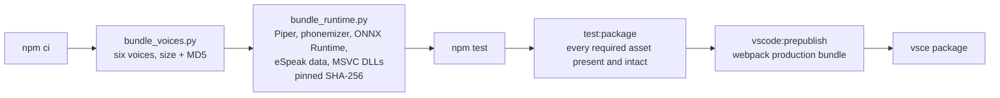

# Build from source

## Quick check of a source checkout

Node.js 22.13 or newer is required.

```sh
npm ci
npm test
npm run webpack
```

The unit tests create temporary fixtures and mock process execution: they need
no voices, native runtime, Python or network. A passing suite does not prove
that real speech works or that a package is complete.

Press ++f5++ in VS Code to start an Extension Development Host with the
bundled launch configuration.

## Project layout

| Path | Contents |
| --- | --- |
| `src/` | extension host code (TypeScript), compiled to `out/` and bundled to `dist/` |
| `media/` | webview scripts, styles and icons |
| `ckeditor5-build-markdown/` | the custom CKEditor 5 build used by the WYSIWYG editor |
| `templates/` | bundled Jinja templates |
| `resources/` | voice catalog; voices and runtimes when prepared |
| `scripts/` | asset bundlers (Python, build time only) |
| `tests/` | Node tests, optional browser tests and fixtures |
| `docs/`, `mkdocs.yml` | this documentation |

## The full offline package (Linux x64 or WSL)

Python 3.12 or newer is needed **only to build**, never to run.

```sh
npm ci
python3 scripts/bundle_voices.py
python3 scripts/bundle_runtime.py
npm test
npm run test:package
npm run vscode:prepublish
npx @vscode/vsce package --no-dependencies
```



The bundlers download pinned archives and stop if a hash differs, for example
when Microsoft's redistributable URL starts serving a new binary. Models and
platform binaries are not in git; the scripts and the source notices describe
how to rebuild them.

## Windows: `build.bat`

Double-click `build.bat` (Node.js 22.13+). It installs dependencies, runs the
tests, prepares and verifies the offline assets, and writes
`artifacts\markdown-listening-offline.vsix`.

```powershell
# reuse voices and runtimes from an existing offline package
.\build.bat "C:\path\to\existing-offline.vsix"
```

- Missing assets are downloaded with Windows Python 3.12+ and 7-Zip. Missing
  tools are installed with `winget` when available (this can ask for
  administrator approval); otherwise install them by hand and rerun.
- WSL is not required.
- The script stops on the first error and pauses so the result stays
  visible. Set `CI=1` to skip the pause. `build.bat --help` lists the options.

!!! note
    The Windows build scripts were reviewed and their portable parts tested on
    Linux. Running them on Windows has not been verified.

## Reusing assets without building

Extract an offline VSIX and copy its `extension/resources/runtime` and
`extension/resources/voices` folders into the checkout's `resources/` folder.

## Local AI bundle

The local model bundle was removed from the build. `scripts/bundle_ai.py` and
the asset verification skip it when `resources/ai-sources.json` is absent, so
the package builds without it.

## Publishing

Increase `version` in `package.json` first, then build the package and
publish it to the Visual Studio Marketplace and Open VSX:

```sh
npx @vscode/vsce publish
npx ovsx publish -p "$OVSX_TOKEN"
```

To work on the CKEditor build on its own, run `npm start` in
`ckeditor5-build-markdown/`.
