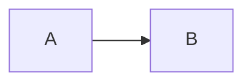

# Writing these docs

This site is built with [MkDocs](https://www.mkdocs.org/) and the
[Material](https://squidfunk.github.io/mkdocs-material/) theme. The
configuration is `mkdocs.yml` in the repository root; pages are in `docs/`.

## Preview and build

```sh
python3 -m venv .venv
.venv/bin/pip install mkdocs-material
.venv/bin/mkdocs serve      # live preview at http://127.0.0.1:8000
.venv/bin/mkdocs build      # static site in site/
```

`strict: true` is set, so a broken link or a missing image fails the build.

## Structure

The site is a hierarchy of six sections, each a folder with an `index.md`
that introduces its pages. Keep each page to one kind.

```text
docs/
├── index.md                  home page
├── getting_started/          tutorial: install and a first tour
├── tutorials/                tutorial: one complete task per page
├── theory_of_operation/      explanation: how and why it works
├── reference/                reference: commands, settings, syntax
├── development/              how-to: build, test, maintain
│   └── validation/           measurement records and their raw data
├── about/                    background, release history, licenses
│   └── third_party/          notices of bundled components
└── assets/                   stylesheet and images
```

| Section | Kind | Rule of thumb |
| --- | --- | --- |
| `getting_started/`, `tutorials/` | tutorial | a complete task, in order, with a visible result |
| `theory_of_operation/` | explanation | how and why it works; diagrams, algorithms, limits |
| `reference/` | reference | complete and checked against `package.json` and source |
| `development/` | how-to | building, testing and maintaining |
| `about/` | background | research, history and legal notices |

**Naming.** Every file and folder under `docs/` uses `snake_case`: lower
case, words joined by `_`, version numbers written as `0_10`. Screenshots end
in `_light` or `_dark`.

**Paths the extension uses.** `docs/about/listening_research.md` is opened by
the extension's **Listen to the Long-Document Reading Guide** command, and it
and `docs/about/third_party/` are shipped in the package (`.vscodeignore`).
Keep those paths, or update `src/extension.ts` and `.vscodeignore` with them.

## Diagrams

Use Mermaid fences; Material renders them in the page's colour scheme.

````markdown

````

## Screenshots

Screenshots live in `docs/assets/images/` in pairs, `NAME_light.png` and
`NAME_dark.png`. The site's stylesheet shows the one matching the reader's
colour scheme, so put both in the same figure:

```markdown
<figure markdown>
  { .screenshot }
  { .screenshot }
  <figcaption>Caption.</figcaption>
</figure>
```

They are rendered from the real webview code with
`scripts/docs/screenshots.py`, which loads each webview's HTML, CSS and
script in headless Chromium with VS Code's Light Modern and Dark Modern theme
variables and a stand-in for the VS Code API:

```sh
npm run test-compile
npm run build:editor
.venv/bin/pip install playwright
.venv/bin/python -m playwright install chromium-headless-shell
.venv/bin/python scripts/docs/screenshots.py
```

The latency chart `voice_latency_{light,dark}.svg` is generated from
`docs/development/validation/native_voices_0_10.json` by `scripts/docs/voice-chart.js`.
