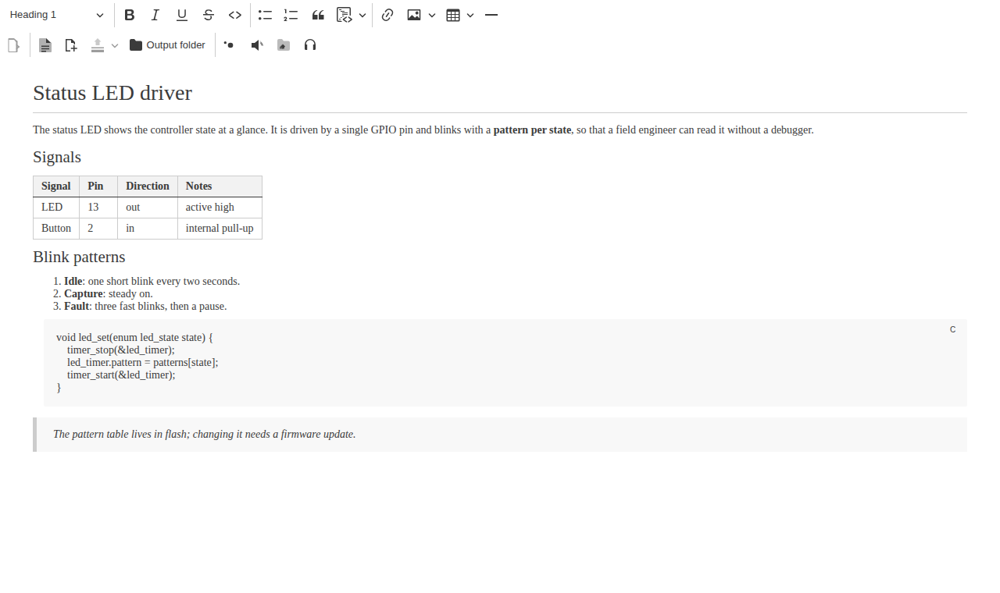
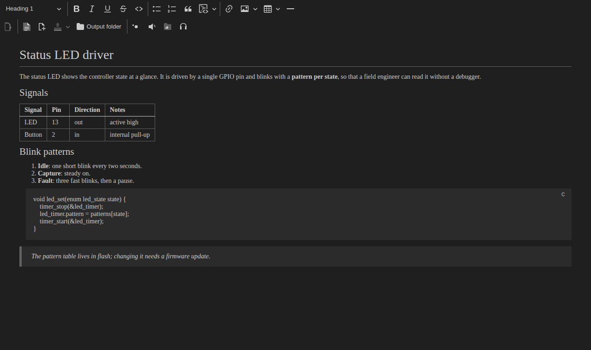

# A first tour

This tour uses each major feature once, in about fifteen minutes. Open a
project folder that contains some Markdown files and source code; the
extension's own repository works well.

## 1. Edit a Markdown file

Open any `.md` file. It opens in the **Markdown WYSIWYG Editor**: headings,
tables and code blocks appear formatted, and the toolbar sits above the
document.

<figure markdown>
  { .screenshot }
  { .screenshot }
  <figcaption>The WYSIWYG editor. The second toolbar row holds the template and listening buttons.</figcaption>
</figure>

Type something, then press ++ctrl+shift+e++ to see the same file as plain
Markdown. Press it again to return. Both views edit the same file.

## 2. Listen to it

Press ++ctrl+alt+shift+r++ (**Read document aloud**). The reader opens beside
the editor and starts reading when it is ready. Try:

- ++alt+shift+right++: next sentence
- ++alt+shift+down++: next heading
- ++alt+shift+l++: "Where am I?", which speaks the heading path and progress

Close the reader and reopen the same document: it resumes near where you stopped.

## 3. Open the documentation mind map

Click the branching **Documentation** icon in the Activity Bar. The tree lists
every document in the workspace with its headings. Click the mind-map icon in
the tree's title bar to see the same structure as a zoomable map, then click a
node to open that section.

## 4. Open the codebase map

Run **Markdown Editor: Open Codebase Map** from the Command Palette
(++ctrl+shift+p++). Your source code appears as islands and hills. Type a file
name into **Go to file…**, press ++enter++, and look at the magenta roads (what
it imports) and teal roads (what imports it). Double-click the hill to open
the file.

## 5. Generate a file from a template

Open the extension's `tests/fixtures/register-map-demo.md` in the WYSIWYG
editor. Click **Template**, choose `templates/register-map-to-yaml.j2`, then
click **Generate**. The YAML file opens beside the editor. Change a register
description in the Markdown and watch the YAML update and scroll to the
change.

## Where to go next

| You want to… | Read |
| --- | --- |
| work through a long specification by ear | [Study a long document by ear](../tutorials/study_long_documents.md) |
| find your way around an unfamiliar repository | [Learn a codebase with the map](../tutorials/codebase_map.md) |
| keep a configuration file and a Markdown table in step | [Keep a table in sync](../tutorials/table_sync.md) |
| understand how any of this works | [Theory of operation](../theory_of_operation/index.md) |
