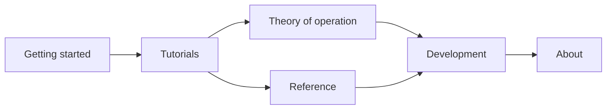

---
hide:
  - navigation
---

# Markdown Editor and Listening Workspace

A Visual Studio Code extension for engineers who write, read and maintain
technical documentation. Everything runs inside VS Code on your own machine:
no document text, source code or speech is sent to a service.

<figure markdown>
  { .screenshot }
  { .screenshot }
  <figcaption>The codebase map: folders are islands, files are hills, imports are roads.</figcaption>
</figure>

## What it does

-   :material-pencil-box-outline: **Edit Markdown visually**

    ---

    Open any `.md` file in a CKEditor-based WYSIWYG editor with tables,
    images, code blocks and rich-text paste. Toggle back to plain text with
    ++ctrl+shift+e++.

    [:octicons-arrow-right-24: Tutorial](tutorials/edit_markdown.md)

-   :material-headphones: **Listen offline**

    ---

    Read Markdown and nine other document formats aloud with a bundled
    Piper speech engine and six English and Hungarian voices. Navigate by
    sentence and heading, bookmark, and resume where you stopped.

    [:octicons-arrow-right-24: Tutorial](tutorials/listen_to_a_document.md)

-   :material-file-tree: **Explore documentation**

    ---

    A **Documentation contents** tree and an interactive mind map of every
    document in the workspace, with listening queues and guided project
    tours.

    [:octicons-arrow-right-24: Tutorial](tutorials/explore_documentation.md)

-   :material-map-outline: **Map a codebase**

    ---

    See source code as a landscape. Get directions between files, walk the
    landmarks and overlay a CPU profile to see which calls happen at run
    time.

    [:octicons-arrow-right-24: Tutorial](tutorials/codebase_map.md)

-   :material-code-braces: **Convert with templates**

    ---

    Turn Markdown into YAML, JSON, TOML, XML, CSV, HTML and more with Jinja
    templates, including templates inferred from a pair of examples, with live
    two-way updates.

    [:octicons-arrow-right-24: Tutorial](tutorials/jinja_templates.md)

-   :material-table-sync: **Synchronize tables**

    ---

    Bind a Markdown table to a configuration file in one of eleven formats.
    Edits on either side flow to the other, with conflict detection and
    backups.

    [:octicons-arrow-right-24: Tutorial](tutorials/table_sync.md)

## How this documentation is organized

The sections build on each other: start at the top, go down as you need more
depth.

| Section | Read it when you want to… |
| --- | --- |
| [Getting started](getting_started/index.md) | install the extension and try each feature once |
| [Tutorials](tutorials/index.md) | learn a feature by doing a complete task, step by step |
| [Theory of operation](theory_of_operation/index.md) | understand how a feature works inside, and why it behaves as it does |
| [Reference](reference/index.md) | look up a command, setting, shortcut, format or template helper |
| [Development](development/index.md) | build, test or package the extension from source |
| [About](about/index.md) | read the research behind listening, the release history or the licenses |

## Platform support at a glance

| | Windows x64 | Linux x64 | macOS, ARM |
| --- | --- | --- | --- |
| WYSIWYG editor, maps, templates | :material-check: | :material-check: | :material-check: |
| Bundled Piper speech engine and voices | :material-check: | :material-check: | custom Piper executable |
| Ten document import formats | :material-check: | :material-check: | :material-check: |

VS Code 1.105 or newer is required. See [Install](getting_started/install.md)
for the difference between the full offline package and the source build.
