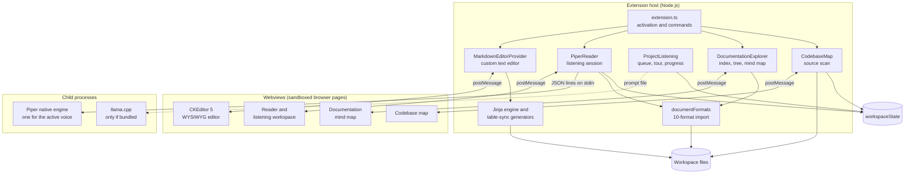

# Architecture

The extension is a single VS Code extension written in TypeScript. It runs in
three kinds of place, and nothing runs on a server.

## The three places code runs

**Extension host.** All file access, parsing of binary formats, template
rendering and process management happen here, in Node.js. The host owns the
truth: documents, settings and saved state.

**Webviews.** Each panel the user sees is a webview, an isolated browser page
with no file or network access of its own. It draws the interface and sends
short messages to the host (`postMessage`). Each webview has a content
security policy that only allows scripts carrying a per-load nonce.

**Child processes.** Speech is produced by the native Piper executable,
started without a shell and kept running while a voice is in use. The local
AI path (when a model bundle is present) starts `llama.cpp` per request.

## Module map

| Module | Responsibility |
| --- | --- |
| `extension.ts` | activation; wires the components together and registers commands |
| `markdownEditor.ts` | `CustomTextEditor` for `*.md`; toolbar requests; live template links |
| `piperReader.ts`, `readerHtml.ts` | the listening session and its webview |
| `listeningDocument.ts`, `speechText.ts`, `readingFilters.ts` | turn text into source-linked speech segments |
| `speechEngine.ts`, `voiceManager.ts` | Piper process, voices, runtime selection, downloads |
| `documentFormats.ts`, `documentLoader.ts` | import of the ten document formats |
| `documentationIndex.ts`, `documentationExplorer.ts` | the documentation tree and mind map |
| `listeningWorkspace.ts`, `projectListening.ts`, `workspaceHtml.ts` | queue, tour, progress, pronunciation, corrections |
| `localAssistant.ts` | optional local model runner |
| `codebaseMap.ts` + `media/codebaseMap.*` | codebase map host and webview |
| `jinjaTemplate.ts`, `jinjaConversion.ts`, `runJinjaTemplate.ts` | Jinja engine and commands |
| `jinjaExampleGenerator.ts`, `createJinjaTemplate.ts` | infer templates from examples |
| `markdownTables.ts`, `registerMapImport.ts` | template context: tables, register maps, reverse sync |
| `codeGenerator.ts`, `outputImport.ts` | table mappings: generate and import eleven formats |

## Design principles

These choices explain much of the behaviour described in the other pages:

1. **Local only.** Document text, source code and audio stay on the machine.
   The only network use is an explicit voice download.
2. **The source file is the truth.** Extracted views of PDFs, corrections,
   bookmarks and progress are overlays keyed to a document fingerprint; when
   the document changes, stale overlays are discarded instead of misapplied.
3. **Deterministic results.** The codebase map layout, the guided tour order
   and the walk are computed without randomness, so they are the same every
   time.
4. **Bounded work.** Every scan, import, synthesis and request has a size or
   time limit, and reports when it is reached rather than silently
   truncating.
5. **Cancellable by generation.** Long operations carry a generation or scan
   number. When the user moves on, older results are ignored when they
   arrive.

## Persistence

| What | Where | Lifetime |
| --- | --- | --- |
| Reading position, bookmarks, skip options | `workspaceState` | per workspace, reset when the document fingerprint changes |
| Queue, heard progress, pronunciation, corrections, focus mode | `workspaceState` | per workspace |
| Codebase map trail and visited files | `workspaceState` (`markdownEditor.codebaseMap.store`) | per workspace, 64 KB per entry |
| Mind map position and collapsed branches | webview state | survives webview reloads |
| Template live links | memory | current VS Code window |
| Output folder | setting `markdownEditor.outputFolder` | user or workspace setting |
