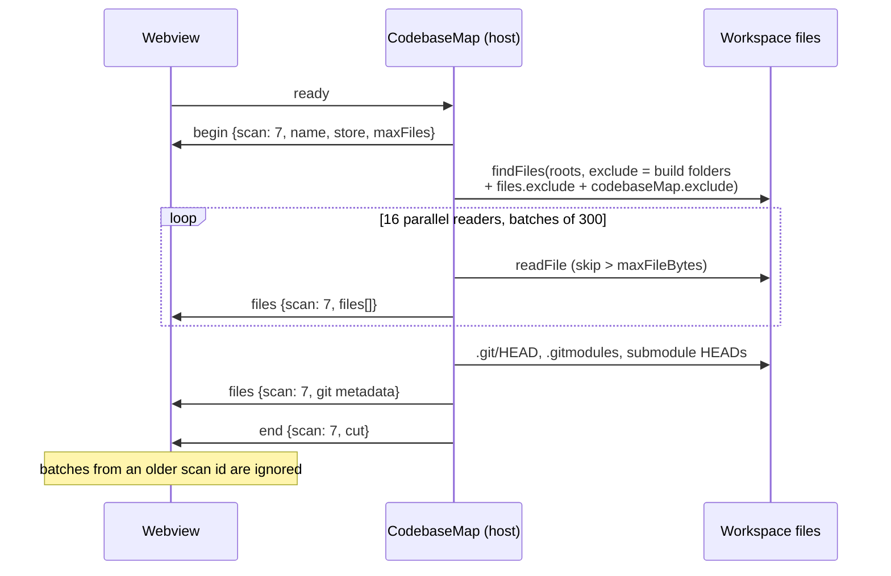
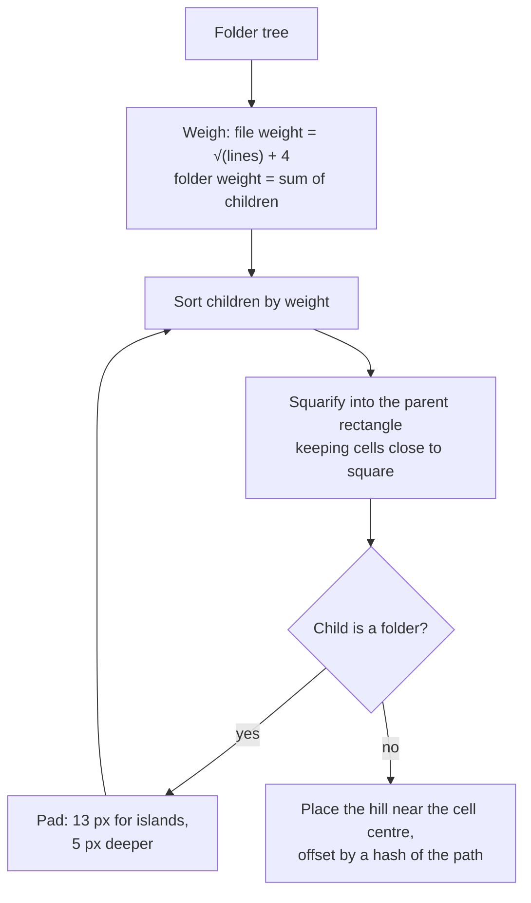
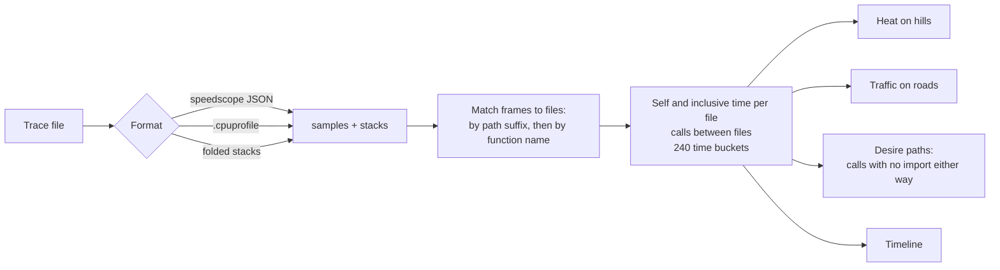

# Codebase map

The codebase map is split cleanly in two. The **extension host** finds and
reads files; the **webview** does everything else: import detection, layout,
terrain, drawing and the Route, Walk and Runtime modes. Source text is only
ever passed from the host to the webview, never anywhere else.

## Scanning

| Message | Direction | Meaning |
| --- | --- | --- |
| `ready` | webview → host | the page has loaded; start a scan |
| `refresh`, `scan`, `pickFolder` | webview → host | rescan the same roots, the whole workspace, or a chosen folder |
| `open {path}`, `reveal {path}` | webview → host | open the file beside the map, or reveal it in the Explorer |
| `store {key, value}` | webview → host | save the trail and visited files (max 64 KB per value) |
| `begin`, `files`, `end` | host → webview | one scan, identified by its scan id |
| `status {text, sticky}` | host → webview | progress and errors |
| `stale` | host → webview | source files changed since the scan |

**Exclusions.** Passing an exclude pattern to VS Code's `findFiles` disables
`files.exclude`, so the host merges the user's `files.exclude` patterns back
in, together with the fixed build and dependency folders and
`markdownEditor.codebaseMap.exclude`.

**Path safety.** Paths in messages are relative to the mapped root (prefixed
with the root's name in a multi-root workspace). `resolve()` rejects empty and
absolute paths and any `.` or `..` segment, so the webview cannot ask the host
to open a file outside the roots.

**Staleness.** A file-system watcher on the roots, debounced by 1.5 seconds,
sends `stale` when mappable files are created, changed or deleted. The map is
not redrawn automatically; the user chooses when with **Refresh**.

**Restoring.** A webview panel serializer reopens the map after a window
reload and scans the same folder again.

## Import detection

Each file's text is matched against patterns for its language family, and
each specifier is resolved against an index of all mapped paths.

| Family | Recognized |
| --- | --- |
| JavaScript, TypeScript, Vue, Svelte | `import … from`, `export … from`, bare `import '…'`, `require('…')`, `import('…')` with a literal |
| Python | `import a.b`, `from a.b import c`, relative `from . import c` |
| Go | single `import "…"` and `import ( … )` blocks |
| Rust | `mod name;` and `crate::`/`super::` paths |
| Java, Kotlin, Scala | `import` and `import static` |
| C# | namespaces declared and used, and type references |
| C, C++, Objective-C | `#include "…"` and `#import "…"` (angle-bracket system headers are ignored) |
| Ruby | `require`, `require_relative` |
| PHP | `require`/`include` (and `_once`), `use` |
| Dart | `import`, `export`, `part` |
| Lua | `require` (dots become slashes) |
| CSS, SCSS, Less | `@import`, `@use`, `@forward` |
| HTML | `<script src>`, `<link href>` |
| Renode | `@file` references, `using "…"`, Robot `Resource`, peripheral types in `.repl` |

Specifiers are resolved against an index of all mapped paths: relative paths,
`@/` and `~/` aliases, package-style dotted paths, index files and missing
extensions are tried.

A specifier that does not resolve to a mapped file is listed as an external
package of the file but not drawn. Files in other languages appear as hills
without roads.

**Mapped file types.** Everything above plus Swift, Elixir, Erlang, Haskell,
Clojure, Julia, R, shell, PowerShell, SQL, SCSS/Less, Markdown,
reStructuredText, JSON, YAML, TOML, XML, Gradle, Protocol Buffers, GraphQL,
Terraform and Robot Framework files. The list lives in `MAP_EXTENSIONS` on the
host and `LANG` in the webview; a test keeps the two identical.

## Landmarks

- **Entry points (stars).** Files named like `main`, `index`, `app`,
  `server` or `cli` that import something and are imported by at most eight
  files, ranked by how many files they can reach through imports; the top
  three are kept. If there is none, the file that imports most and is imported
  by nothing is used.
- **Hubs (towers).** Files imported by at least two others, ranked by number
  of dependents, then size. Between 4 and 12 are kept, about one per ten files.

## Layout

The layout is a **squarified treemap** of the folder tree, so that nearby
files are related by folder and the same tree always gives the same picture.

- The square root keeps one huge file from swallowing its folder.
- Top-level folders become **islands** (regions); a large single root is split
  into its subfolders so that there are several regions.
- The hill's small offset comes from a hash of its path, not from a random
  number: the map looks natural but never changes between sessions.

## Terrain

The landscape is computed on a grid 560 cells wide:

1. Each island is a rounded rectangle; distance to its edge, perturbed by two
   octaves of value noise, gives a land mask with a natural coastline.
2. Every file adds a bump whose height depends on its lines of code (or its
   number of dependents, if chosen).
3. The height field is smoothed with a box blur.
4. Contour lines are traced at fixed levels (iso-lines on the grid), then the
   map is shaded with the theme's colours.

## Roads and highways

Every resolved import is a road, drawn as a slightly curved line between two
hills. In survey view, imports between two regions are bundled into one
**highway** whose width grows with the number of imports. Highways that cross
between git repositories (submodules) are dashed.

## Route and Walk

**Route** uses breadth-first search on the import graph:

1. First following imports only in their direction (a call chain); the result
   has the fewest steps.
2. If there is none, again with edges in both directions; those steps are
   marked as going against the import.
3. If there is still none, the two files are in disconnected parts of the
   graph.

Each step is described with a compass bearing computed from the hills'
positions, and with the regions and repositories crossed.

**Walk** orders the landmarks with a nearest-neighbour tour: start at the main
entry point, then repeatedly go to the closest unvisited landmark. It is not
the shortest possible tour, but it is short, stable, and easy to remember.

## Runtime overlay

Frames that match no file are counted as outside the map, and the panel says
what share of the time it could place. A desire path is a call between two
files where neither imports the other: callbacks, events, interfaces,
dependency injection or reflection.

## Display state

The selected file, trail and visited set are saved through `store` messages
into `workspaceState`, keyed by the map's name. **Fog of war** is computed
from the visited set; landmarks are always visible. Colours come from the VS
Code theme, so the map follows light, dark and high-contrast themes.
