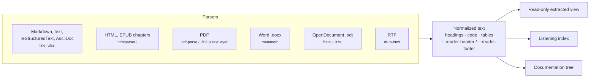

# Document import

The reader and the documentation index accept ten format families. Each one is
converted, locally, into the same intermediate form: **Markdown-like text with
headings, code marked as code, and running headers and footers marked as
such**. Everything downstream (outline, filters, speech, mind map) works on
that form.



## Per-format rules

| Family | Outline from | Code detected from | Running header/footer from |
| --- | --- | --- | --- |
| Markdown | ATX and Setext headings | fences, indentation, backticks | HTML `<header>`/`<footer>`, reader markers |
| Plain text | — | — | reader markers only |
| HTML | `h1`–`h6` | `pre`, `code`, monospace styles | `header`/`footer` elements, banner/contentinfo roles |
| PDF | one node per page | not reliably | lines repeated at the top or bottom of at least 60 % of pages (minimum two) |
| Word | heading styles | `Code`/`Source Code` styles | the document's header and footer parts |
| OpenDocument | outline levels | code, source and preformatted styles | header/footer content in `styles.xml` |
| EPUB | spine order, then HTML headings | as HTML | chapter `header`/`footer` markup |
| RTF | not guaranteed | monospace formatting | RTF header/footer groups |
| reStructuredText | underlined headings | code and source directives, literals | `header` and `footer` directives |
| AsciiDoc | `=` headings | listing and source blocks | reader markers |

## The PDF running-header heuristic

A PDF has no notion of a page header; it only has text positioned on a page.
The importer looks at the first and last non-empty lines of every page. A line
that repeats on at least 60 % of the pages (and on at least two) is treated as
a running header or footer, and is wrapped in a reader marker so that the
**Skip running headers/footers** options can remove it. A banner that changes
from page to page (for example one containing the chapter name) is not
detected.

## Explicit markers

For formats with no header/footer structure, mark the regions yourself, either
in the source or through **Correct extracted structure**:

```markdown
:::reader-header
Repeated report title
:::

# Actual section heading
Main body.

:::reader-footer
Company contact details
:::
```

## Limits and safety

| Limit | Value |
| --- | --- |
| Input file for the reader | 64 MiB |
| Extracted text | 8 MiB |
| Expanded size of ZIP-based documents (DOCX, ODT, EPUB) | 64 MiB, 10,000 entries |
| File size when indexing | 32 MiB by default (`markdownEditor.documentation.maxFileBytes`) |

- Scanned PDFs have no text layer and need OCR first. Encrypted PDFs and DRM
  EPUBs are rejected.
- Legacy `.doc`, spreadsheets and presentations are not supported.
- Include directives, scripts, embedded objects and remote resources are never
  executed or fetched.
- reStructuredText and AsciiDoc support is an extraction subset, not a full
  Sphinx or Asciidoctor renderer.

## Where the result goes

Imported documents open as a **read-only extracted view**; navigating from the
outline or the mind map opens the view at the right line. The original binary
file is never modified. Corrections are stored separately, see
[Listening workspace](listening-workspace.md#corrections).
