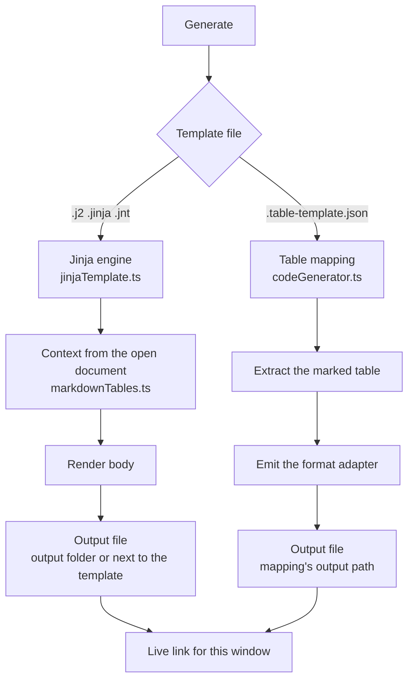
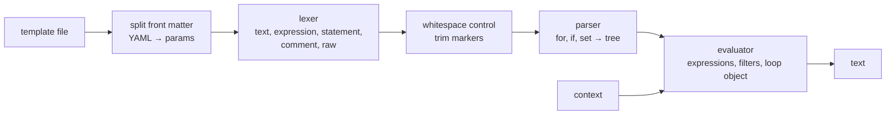
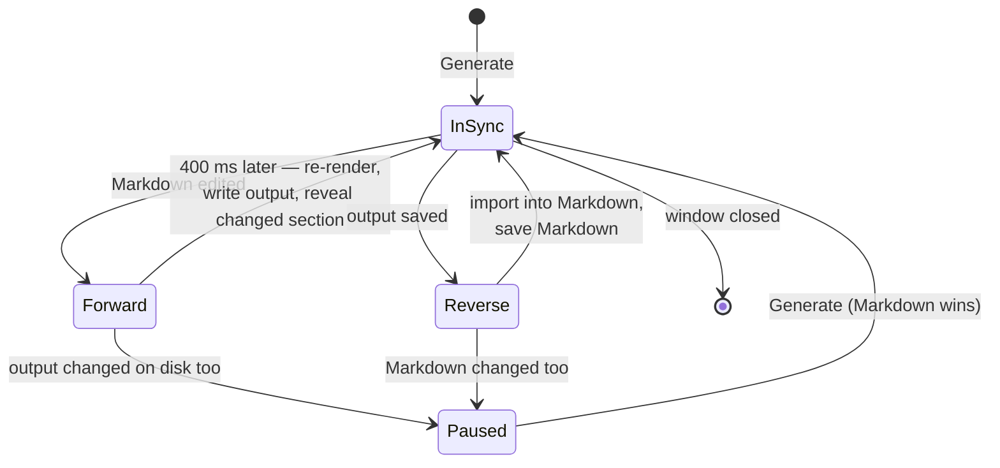
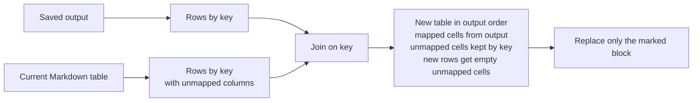

# Templates and synchronization

The toolbar's **Generate** button drives two engines. Which one runs depends
on the file chosen with **Template**:

## The Jinja engine

`jinjaTemplate.ts` is a self-contained implementation of a useful subset of
Jinja in TypeScript: no Python, no external process.

- **Expressions** are tokenized and parsed by a precedence-climbing parser:
  literals (including `0x` hex), lists, slices, attribute and index access,
  calls, arithmetic, comparisons, `and`/`or`/`not`, conditional expressions
  and filter chains.
- **Leniency follows Jinja.** Undefined names render as empty, and attribute
  access on a missing value gives `null`. Unknown filters and tags are errors
  with a clear message, because a typo there is never intended.
- **Context.** For a Markdown source, `markdownTables.ts` builds `source`,
  `title`, `markdown`, `tables`, `table`, `rows`, `headers`, and `params` from
  the front matter. Register rows also get their prose description and nested
  table. For YAML or JSON sources with a `types` mapping, `register_map` and
  `types` are filled instead. The full list is in the
  [Jinja reference](../reference/jinja.md).

## Inferring a template from examples

`jinjaExampleGenerator.ts` works backwards from a source and the output you
expect:

1. **Bind source values.** Every heading, table cell (Markdown) or field (JSON,
   YAML) becomes a binding: a value and the expression that produces it, such
   as `rows[2].Name`.
2. **Find them in the expected output.** Each binding's value is searched for
   in the expected text, taking the output format's quoting into account.
3. **Infer loops.** When two or more records of the same collection appear in
   a repeating pattern, the repeated block becomes a `` loop over that
   collection.
4. **Substitute.** Matched text becomes `{{ expression }}`; everything else
   stays literal.
5. **Verify.** The generated template is rendered against the source; if the
   result is not exactly the expected output, it is rejected.

Ambiguity is the main risk: if two columns hold the same value in the
example, the generator cannot tell which one the output used. Distinct values
in every cell avoid this.

## The live link

After a successful Generate, the editor holds an **output link** for the
current window: source path, output path, format, and two **baselines** (the
last synchronized text of each side).

**Forward** (Jinja only). Markdown edits are debounced by 400 ms, then the
template is rendered again. Before writing, the output on disk is compared to
its baseline; if someone else changed it, sync pauses and both files are kept.
The register sections of the old and new source are fingerprinted; the
changed register's span is found in the output through its `@register <name>`
marker, and the output editor selects it.

**Reverse.** A file-system watcher and the save event trigger an import when
the output changes. It is skipped while the output has unsaved changes, and
paused if the Markdown was also changed. The reverse function depends on the
template:

| Template | Reverse function |
| --- | --- |
| `register-map-to-yaml.j2`, `register-map-to-json.j2` (or `reverse: register-map`) | `importRegisterMap`: updates register cells and nested field or enum tables, keeps offsets and surrounding text |
| `reverse: path/to/reverse.j2` in front matter | renders that template with the edited output as `markdown`, plus `original_markdown` and `previous_output`; its result replaces the source |
| table mapping, readable format | `importMappedOutput`, see below |
| anything else | none: the link is one-way |

Every step re-checks the baselines just before writing, so a change that
arrives while a render is running is never overwritten.

## Table mappings

A mapping (`*.table-template.json`) binds one marked Markdown table to rows in
an output file. See the [mapping reference](../reference/table-mapping.md) for
the schema and per-format layouts.

**Generate** extracts the rows between
`<!-- table-sync:NAME -->` and `<!-- /table-sync:NAME -->`, converts each cell
to its column type, and writes the whole output file with the format's
adapter. An existing output is first copied to `<output>.table-sync.bak`.
Output-only fields are not merged back in.

**Import** (for YAML, JSON, TOML, XML, HTML, CSV, TSV, INI, `.env` and
`.properties`) reads the rows from the saved output and rebuilds only the
marked table:

Keys must be unique and non-empty, or the import stops. Pipes are escaped as
`\|` and line breaks become ` `. DOCX output is generated as a plain Word
table and is not read back; generation from a corporate DOCX master is not
available in this build.
