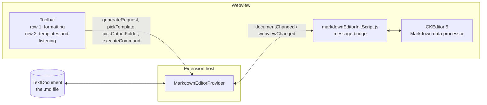
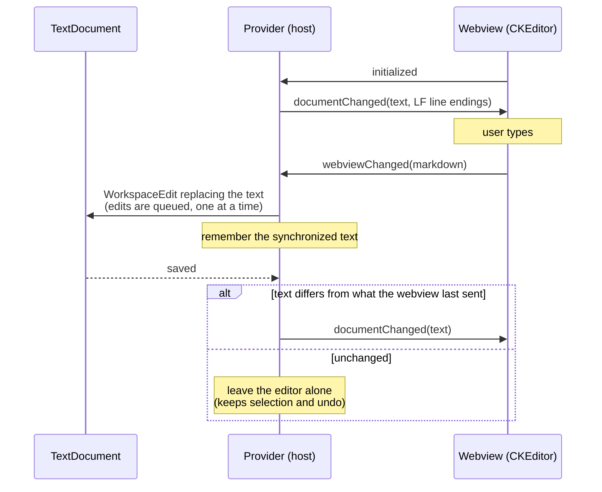

# WYSIWYG editor

The visual editor is a VS Code **custom text editor**: VS Code keeps owning
the `TextDocument` (with its undo stack, dirty state, saving and backups), and
the extension supplies a webview that shows and edits it. Inside the webview
runs a custom build of **CKEditor 5** with Markdown input and output
(`ckeditor5-build-markdown/`).

## Components

## Keeping the document and the editor in step

The document is the model; the webview is a view that can also edit it.

Points worth knowing:

- **Formatting on the way back.** The Markdown that CKEditor produces is
  formatted with Prettier's Markdown formatter before it is written, so the
  file has a consistent style (list markers, table alignment, blank lines).
  `table-sync` markers are preserved through this step.
- **Edits are serialized.** Each `webviewChanged` waits for the previous
  `WorkspaceEdit`, so fast typing cannot apply edits out of order.
- **Line endings.** CKEditor works with `\n`. The provider converts when it
  sends text, and writes back with the document's own end-of-line setting.
- **Changes made elsewhere** (for example in the plain-text editor in a
  split) reach the visual editor when the document is saved, not on every
  keystroke. This avoids resetting the cursor and undo history while you
  type.
- **Toggling** with ++ctrl+shift+e++ reopens the same document with the other
  editor; there is one file and one undo history in VS Code.

## The toolbar's second row

The second row is not part of CKEditor's editing model. Its buttons send
messages to the host:

| Button | Message | Host action |
| --- | --- | --- |
| Template | `pickTemplate` | file dialog; remembers the template and its default format |
| Format | (local state) | chosen format is sent with the next generate request |
| Output folder | `pickOutputFolder` | updates `markdownEditor.outputFolder` |
| Generate | `generateRequest` | Jinja render or table-mapping generation, see [Templates](templates.md) |
| Create Jinja template, Mind map, Read aloud, Open document, Listen | `executeCommand` | runs the matching extension command |

If the message bridge did not start (for example because the webview failed
to load a script), the buttons say so in their label instead of doing
nothing.

## Paste

Rich-text paste uses CKEditor's paste-from-Office support and converts the
HTML to Markdown. VS Code has no plain-paste shortcut of its own, so
++ctrl+shift+v++ sends `plainPaste` to the host, which runs VS Code's paste
action while CKEditor sees the Shift key and inserts plain text.

## Limits

- Markdown that CKEditor cannot model (raw HTML blocks, some list spacing) is
  normalized when the editor writes the document back.
- Saving clears CKEditor's undo history.
- The outline and breadcrumbs are empty for custom editors in VS Code.
