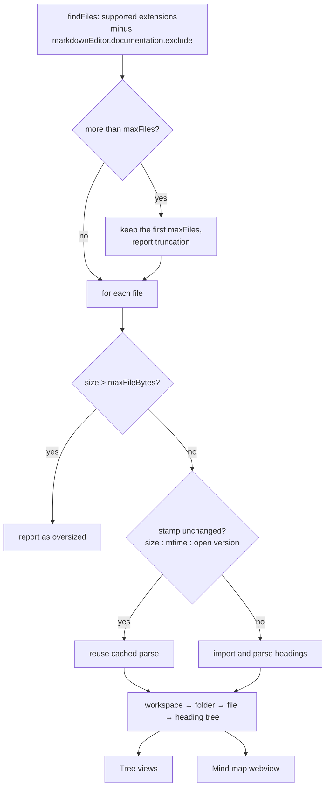

# Documentation index and mind map

The **Documentation contents** tree and the mind map are two views of one
index, built by `DocumentationExplorer`.

## Building the index

- **Cache.** Each file's parse is stored with a stamp made of its size,
  modification time and, for open documents, the editor version. Only changed
  files are parsed again, so refreshing a large project is cheap.
- **Unsaved changes count.** An open document's current text is used, so the
  outline follows your typing.
- **Refresh triggers.** Saving, creating or deleting files, and changing
  workspace folders refresh the index automatically. **Refresh documentation
  index** forces a full rescan.
- **Limits.** 2,000 files and 32 MiB per file by default. Oversized,
  unreadable and truncated files are reported in the status bar and the map.

## Headings

`headings()` recognizes ATX (`#`) and Setext (underlined) headings and skips
anything inside code fences. PDF documents use one node per page. Converted
formats get their headings from the [importer](document_import.md).

## The mind map

The webview (`media/documentationMap.js`) lays the tree out left to right:
workspace, folders, files, then heading levels. It adds:

- **link nodes** for relative links between documents, drawn dashed (links
  are read from the text; nothing is fetched);
- **progress**: heard-passage share, reached-end markers and bookmark counts
  from the [listening workspace](listening_workspace.md);
- the **current file and section** highlighted while you listen.

To stay responsive, at most **3,000 nodes** are drawn at once. Collapsed
branches, level presets, search and focus (◎) reduce the visible set; when
the limit is reached anyway the map says so. Zoom, pan and collapsed branches
are kept in the webview state and survive reloads.

## Commands from the map

Clicking a label sends the file and line to the host, which opens the source
(or the extracted view) there. The play button asks the host to start the
reader at that heading.
