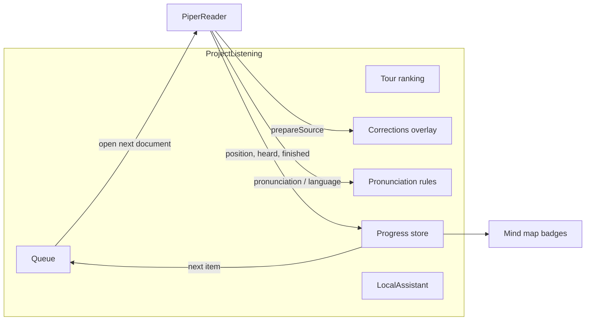
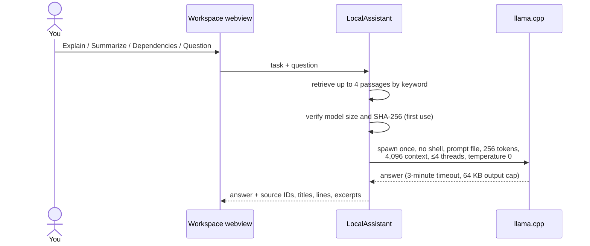

# Listening workspace

`ProjectListening` and `ListeningWorkspace` turn single-document reading into
project-level study: a queue, a guided tour, progress, pronunciation,
corrections and (optionally) a local model. They sit next to the
[speech pipeline](speech_pipeline.md) and feed it through hooks.

## Queue

The queue is an ordered list of document URIs in `workspaceState`. When the
reader reports **finished** for the current document and automatic
continuation is on, the next entry is opened at its saved position. **Return
to previous document** walks a separate cross-document history.

## Guided tour

The tour is a ranking, not an inference. Each document gets a score from its
title:

| Title matches | Score |
| --- | --- |
| readme, overview, introduction | 0 |
| architecture, design | 10 |
| install, setup, getting started | 20 |
| tutorial, example | 30 |
| anything else | 40 |

With a topic, documents whose title or text contain a topic word get −50, and
documents that mention none of the words are dropped (README and overview
documents are kept for context). Ties are broken alphabetically and at most 30
documents are queued. Because nothing is random, the same project and topic
always give the same tour.

## Progress

For each document the store keeps a fingerprint, the position, the set of
**heard** segments and a **reached end** flag.

- A segment counts as heard only when its audio reported that it finished
  playing; skipping over it does not count.
- *Reached end* means playback got to the end; it does not mean every segment
  was heard.
- When the fingerprint changes (the document was edited), the old progress is
  discarded instead of being applied to different text.

The mind map shows the heard share, the end marker and bookmark counts.

## Pronunciation and language

Rules are whole-token literal substitutions applied to the text sent to
Piper. A rule for `en` or `hu` overrides an `any` rule for the same term; up
to 1,000 rules are kept.

In **automatic** language mode, each segment is classified with a small local
heuristic: Hungarian if it contains `ő` or `ű`, or several common Hungarian
words. The segment is then read with the bundled English or Hungarian voice.
Short or mixed technical passages can be misclassified; force a language when
it matters. Look-ahead synthesis only runs when the next segment has the same
language as the current one, so a language switch never uses the wrong voice.

## Corrections

**Correct extracted structure** stores an edited copy of the extracted text
per workspace, up to 200,000 characters. `prepareSource` substitutes it
whenever the reader loads that document, but only while the original
extraction is unchanged; if the source file changes, the correction is
ignored. **Reset** deletes it. Skip options still apply to corrected text.

## Local AI assistant

!!! warning "Not bundled in the current build"
    The model and runtime were removed from the package. Without them, the
    assistant reports *Bundled local AI is missing* and does nothing else.
    This section describes the code path for builds that include a bundle.

When a bundle is present (`resources/ai/manifest.json` with the model and a
`llama.cpp` runtime for the platform), a request works like this:

- **Retrieval** splits each document into chunks of about 1,600 characters
  and scores them by how many query words they contain (title matches count
  triple). It is keyword relevance, not semantic search.
- **Summary** covers the current heading section in up to 16 chunks; a larger
  section asks you to pick a smaller heading instead of truncating silently.
- The prompt tells the model that passages are untrusted data and to cite
  source IDs. The model has no tools: no shell, file or network access.
- Only one request runs at a time; **Cancel AI** kills the process.

Answers are shown separately from the source text with links back to the
passages used. A link shows what the model was given, not proof that every
claim is supported.
