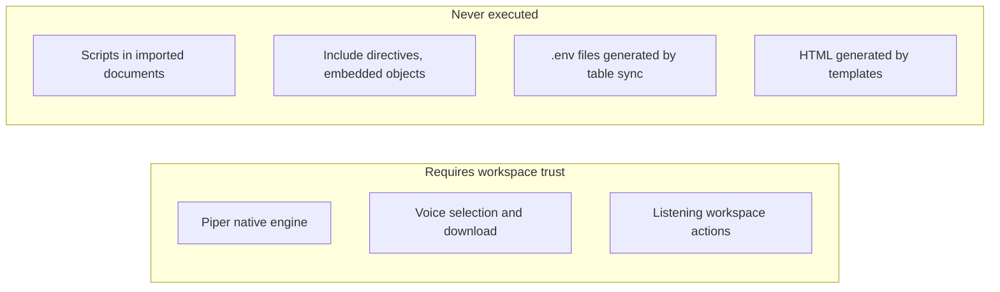

# Security and privacy

## What leaves the machine

| Data | Sent anywhere? |
| --- | --- |
| Document text, Markdown, imported documents | No |
| Source code read by the codebase map | No; only from the extension host to its own webview |
| Synthesized speech | No; WAV files are temporary and deleted |
| Prompts to the local model (when bundled) | No; a local process with no network tools |
| Voice download | Only when you click **Use / Download voice** for a voice that is not installed: an HTTPS request to the voice catalog host |
| Links in documents and in *About this map* | Only when you click them; external links are never fetched for the mind map |

## What is executed

- **Workspace trust.** Running Piper, selecting or downloading voices, and the
  listening workspace's actions refuse to run in an untrusted workspace.
- **No shell.** Piper and the local model are started with `spawn` and an
  argument list, never through a shell. Document text is passed as JSON data
  on standard input, so it cannot become a command.
- **Fixed executables.** With `executable: auto`, the engine comes from the
  installed extension, not from the workspace. The local model runtime is
  taken only from the extension's own folder.
- **Templates are data.** The Jinja engine evaluates expressions and filters
  in its own interpreter; it has no access to files, processes or the
  network. Generated `.env`, HTML and other files are written, not run.

## Webview isolation

Every panel is a webview with a content security policy:

| Webview | Policy (summary) |
| --- | --- |
| Reader and listening workspace | `default-src 'none'`; scripts and styles only with the page nonce; audio only from `data:` URLs |
| Documentation mind map | `default-src 'none'`; scripts with nonce; styles and images from the extension |
| Codebase map | `default-src 'none'`; scripts with nonce; styles from the extension; no remote fonts, scripts or `fetch` |
| WYSIWYG editor | scripts only with the page nonce |

Webviews have no file-system access. Whatever they ask for goes through
messages that the host validates. For example, the codebase map's `open` and
`reveal` requests are resolved against the mapped roots, and paths that are
absolute or contain `.` or `..` segments are refused.

## Integrity of bundled assets

- Native runtimes are checked against a SHA-256 manifest when the package is
  built, and the prepublish step fails if a required file is missing or
  corrupted.
- Voice models are checked against the catalog's size and MD5. These detect
  corruption; MD5 is not a signature.
- A local model bundle, when present, is checked by size on every use and by
  SHA-256 before first use.

## Limits on input

Every importer and scanner has a bound (file size, extracted size, ZIP
expansion, entry counts, file counts, request time). Malformed, encrypted or
oversized inputs are rejected with a message instead of being partly
processed. See [Document import](document_import.md#limits-and-safety) and
[Settings](../reference/settings.md).

## Accessibility claims

The reader uses native, labelled controls, a logical tab order, visible focus
and modifier-based shortcuts that do not take over screen-reader browse keys.
It has not been tested with blind users or with NVDA, and it is not a
replacement for an operating-system screen reader.
