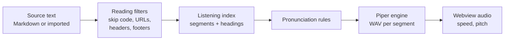
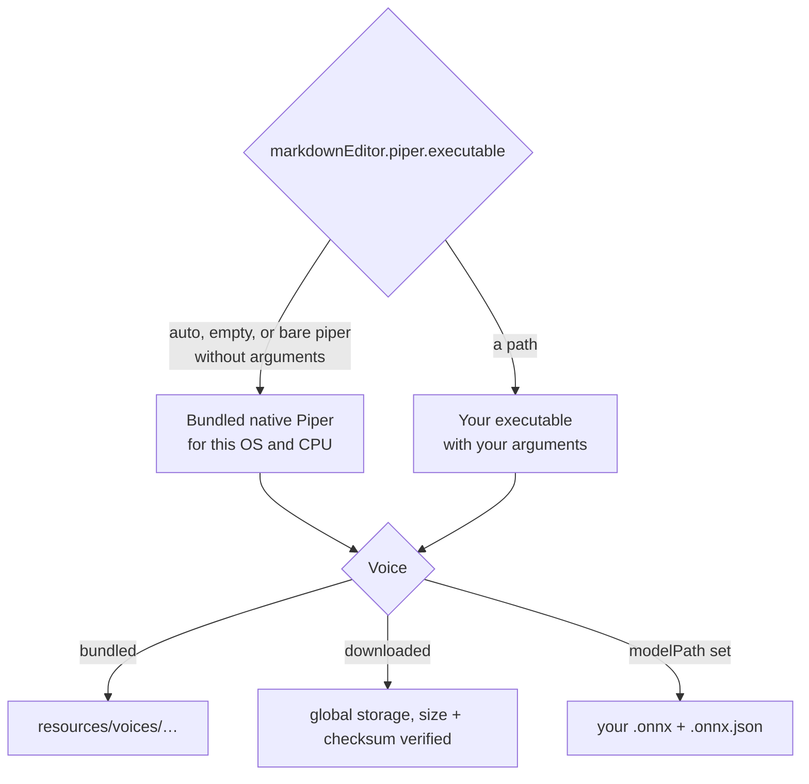
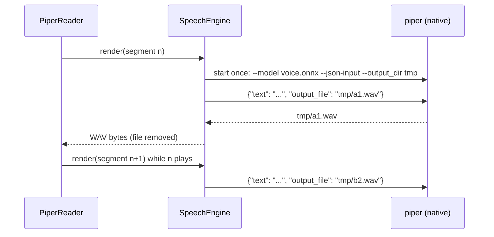
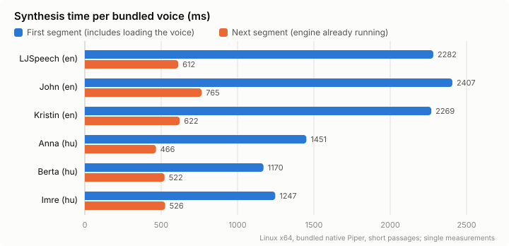
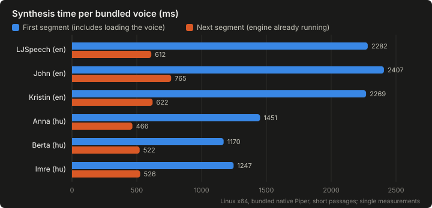

# Speech pipeline

Reading a document aloud takes five stages. Each stage keeps a link back to
the source line, which is what makes sentence navigation, "Where am I?" and
synchronized highlighting possible.

## 1. Reading filters

`readingFilters.ts` removes what you chose to skip: code blocks and inline
code, URL addresses (keeping the link text), and running page headers and
footers detected by the [importer](document_import.md). Headings are never
removed. Changing a filter rebuilds the index and moves to the segment
nearest the current source line.

## 2. The listening index

`listeningDocument()` walks the text line by line and produces:

- **segments**: the unit of playback, each with its text, `sourceLine`,
  paragraph number, heading path and kind (`heading`, `sentence`, `code`,
  `table`, `image`, `math`);
- **headings**: title, level and the index of their first segment;
- a word count, used for the remaining-time estimate.

Rules applied while indexing:

| Source | Becomes |
| --- | --- |
| ATX (`#`) and Setext headings | a heading segment, and an entry on the heading path |
| paragraphs | one segment per sentence; very long sentences are split at punctuation so that one segment never takes too long to synthesize |
| tables | one segment per row, with each value preceded by its column label |
| images | their alternative text |
| fenced or indented code | skipped with an announcement, or read when code reading is on |
| HTML comments | skipped |

The index is linear in the size of the document: a 40,000-sentence document
is covered by the tests.

## 3. Pronunciation

Before synthesis, each segment's text passes through the pronunciation rules
(whole-token, literal replacements; a language-specific rule beats an `any`
rule). The displayed text is not changed.

## 4. Piper

`voiceManager.ts` chooses the runtime:

`SpeechEngine` starts the bundled engine **once** in JSON-input mode, with the
voice model loaded:

- Requests are answered in order; each has a 120-second timeout.
- WAV output is validated before use; temporary files are deleted.
- A custom (non-native) executable is started once per segment instead.
- The process is started without a shell, and only in a trusted workspace.

Measured on Linux x64 with the bundled engine, the first segment of a session
includes loading the model; later segments are much faster:

<figure markdown>
  
  
</figure>

??? note "Data table"

    | Voice | First segment (ms) | Next segment (ms) |
    | --- | --- | --- |
    | LJSpeech (en) | 2,282 | 612 |
    | John (en) | 2,407 | 765 |
    | Kristin (en) | 2,269 | 622 |
    | Anna (hu) | 1,451 | 466 |
    | Berta (hu) | 1,170 | 522 |
    | Imre (hu) | 1,247 | 526 |

These are single measurements on short passages, not a performance guarantee.
The data is in `docs/development/validation/native_voices_0_10.json`.

## 5. Look-ahead and playback

`PiperReader` keeps a small working set of audio, from one segment behind to
two ahead of the current one, and starts synthesizing the next segment while
the current one plays (when both are in the same language, so the same voice
applies). It never pre-generates a whole document.

The WAV is sent to the webview, which plays it with an `<audio>` element.
Speed (0.5×–4×) is the element's playback rate with pitch preservation;
synthesis itself is always at normal speed. Where the host exposes it, the
Media Session API connects headset and media keys.

## Cancellation

Every playback request carries a **generation number**. Navigation, stop,
changing the voice or filters, and closing the reader increase it; audio that
arrives for an older generation is discarded. Stop and close also end the
Piper process and clean up its temporary directory.

## Saved position

The reader stores the position and bookmarks per workspace together with a
SHA-256 fingerprint of the document. Reopening an unchanged document restores
them; a changed document starts fresh instead of jumping to the wrong place.
