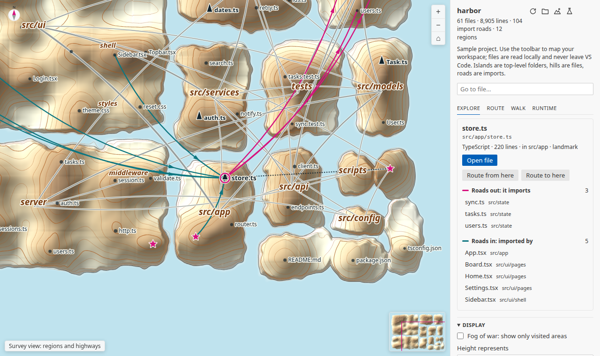
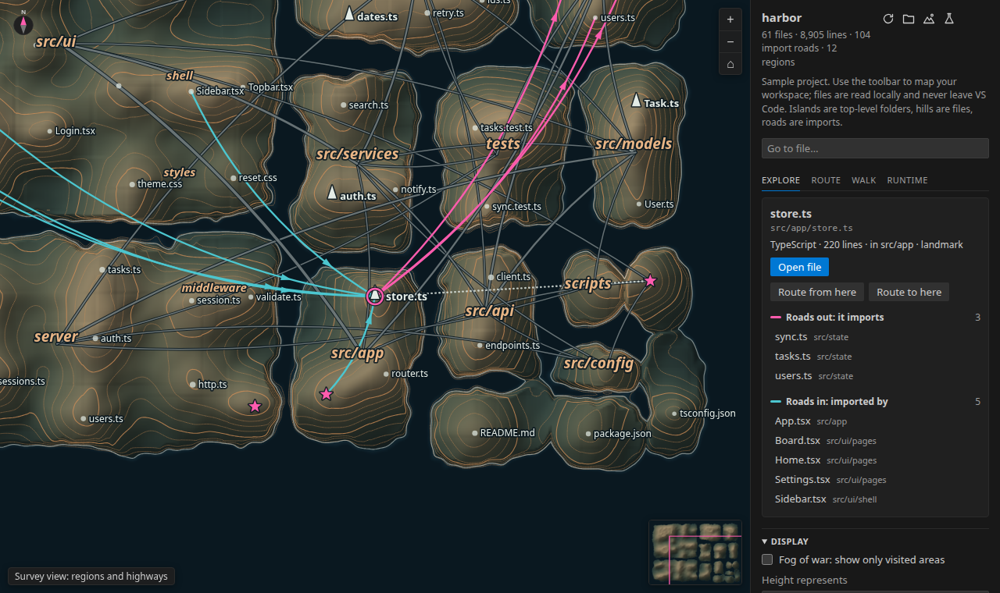
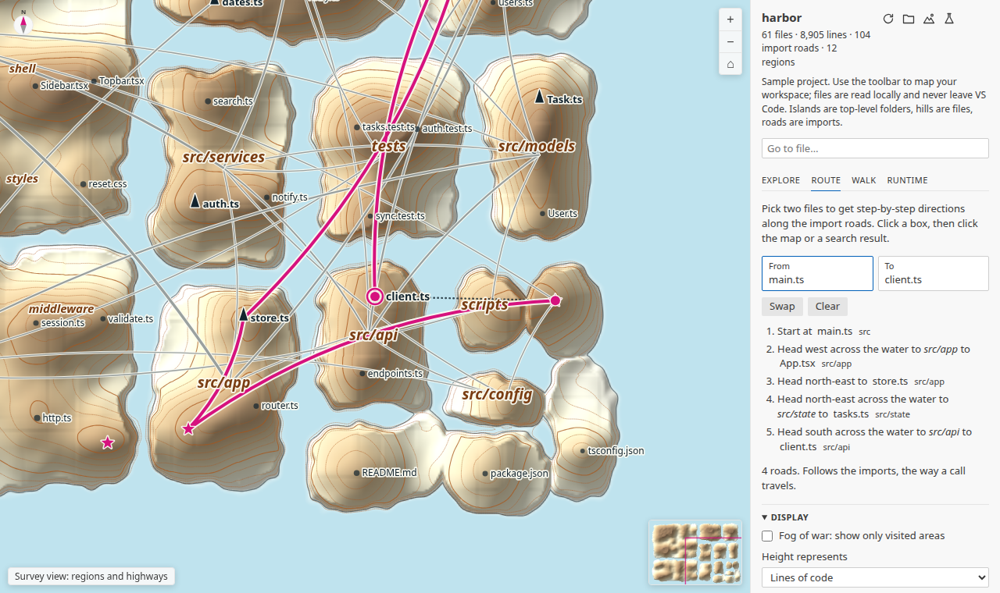
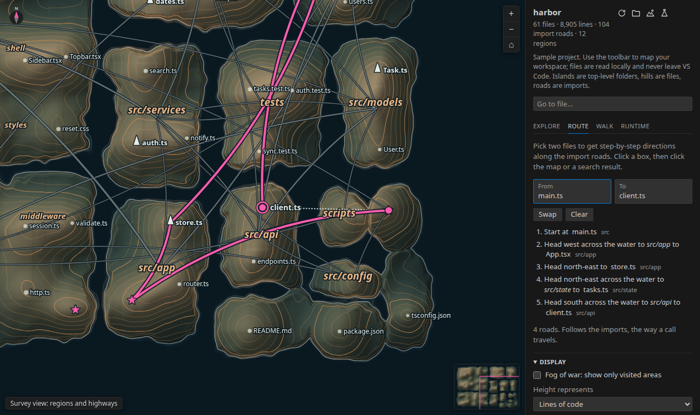
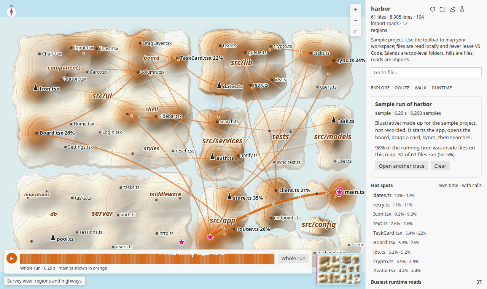
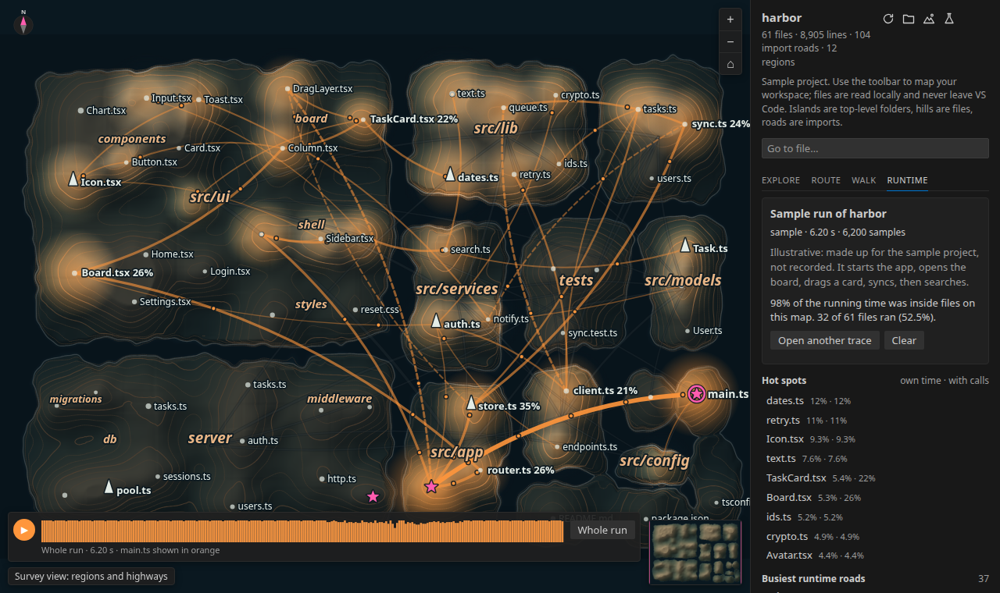

# Learn a codebase with the map

The codebase map draws a project's source code as a landscape, so you can
learn its structure the way you learn a place. In this tutorial you orient
yourself in an unfamiliar repository, find the important files, plan a route
between two of them, and overlay a CPU profile.

| On the map | Means |
| --- | --- |
| Island | a top-level folder; the sea between islands marks module boundaries |
| Hill | a file; height is lines of code (or number of dependents) |
| Road | an import; highways bundle the imports between regions |
| Tower | one of the most-imported files |
| Star | an entry point (`main`, `index`, `app`, `server`, `cli`, …) |
| Purple dashed border | a git submodule |

## 1. Open the map

Use any of:

- **Markdown Editor: Open Codebase Map** in the Command Palette;
- the landscape icon in the **Documentation contents** title bar;
- **Open Codebase Map** on a folder's context menu in the Explorer, to map
  only that folder (on a file, it maps the file's folder).

The extension reads the source files (skipping dependencies and build output)
and the map is drawn as the files arrive.

<figure markdown>
  { .screenshot }
  { .screenshot }
  <figcaption>The built-in sample project, with a file selected: its imports in magenta, its dependents in teal.</figcaption>
</figure>

!!! tip "No project at hand?"
    Click the flask icon in the side panel's toolbar to load the built-in
    sample project.

## 2. Survey before you dive in

Zoomed out, the map is in **survey view**: regions and the highways between
them. Ask yourself three questions:

1. **Which islands are biggest?** That is where most of the code is.
2. **Where are the towers?** Those files are imported by many others: the
   shared vocabulary of the project.
3. **Where are the stars?** Execution starts there.

Pan by dragging (or the arrow keys when the map has focus) and zoom with the
mouse wheel, ++plus++ / ++minus++ or the buttons. ⌂ shows everything again, and
clicking the overview in the corner jumps there.

## 3. Read one file's neighbourhood

Type part of a file name into **Go to file…** and press ++enter++, or click a
hill. Zoomed in far enough, the map switches to **street view** and labels
every file.

The **Explore** tab shows the file's language, size, region and repository,
the files it imports, the files that import it, and the external packages it
uses. On the map, outgoing imports are magenta and incoming ones teal.

- **Open file**, or double-clicking the selected hill, opens it beside the
  map.
- **Reveal in Explorer** shows it in the file tree.

As you move, a dotted trail records where you have been. Your trail and
visited files are kept per workspace.

## 4. Get directions

Open the **Route** tab. Click the start box, then a hill (or a search result);
then the destination box, then another hill.

<figure markdown>
  { .screenshot }
  { .screenshot }
  <figcaption>Step-by-step directions along import edges, with compass bearings and regions crossed.</figcaption>
</figure>

The route follows the imports the way a call travels. If no one-way chain
exists, it mixes roads in both directions and marks the backward steps. "No
road connects these two files" means they belong to separate parts of the
system.

## 5. Walk the landmarks

The **Walk** tab is a fixed tour: it starts at the main entry point and moves
to the nearest unvisited landmark each time. Because the layout is
deterministic, the same walk takes the same path every time, which helps you
remember the architecture as a route.

## 6. See what happens at run time

Static imports do not show callbacks, events, interfaces or reflection. A CPU
profile does.

1. Record a profile of the program. Supported formats:
    - [speedscope](https://www.speedscope.app/) JSON;
    - Chrome or Node.js `.cpuprofile` (for example `node --cpu-prof app.js`);
    - folded stacks (`.folded`, `.collapsed` or `.txt`), as produced by
      `stackcollapse` scripts and many profilers.
2. Open the **Runtime** tab and click **Open a trace**, or drop the file on
   the map.

<figure markdown>
  { .screenshot }
  { .screenshot }
  <figcaption>The runtime overlay: hills glow with time spent, dashed desire paths are calls with no import behind them.</figcaption>
</figure>

Hills glow with the time spent in them and moving dots show calls. Dashed
**desire paths** mark calls between files that have no static import. Use the
timeline to play or scrub through the run, or click **Whole run**.

## 7. Display options

- **Fog of war** hides everything you have not visited yet; landmarks stay
  visible. Use it to test yourself: can you find a file before revealing it?
- **Show git submodules as territories** draws each submodule with a purple
  dashed border, nested ones tinted deeper. The side panel lists repositories
  and the imports between them.
- **Height represents** switches between lines of code and number of
  dependents.

## 8. Keep it current

When source files are created, changed or deleted, the panel shows **Files
changed since this map was drawn** with a **Refresh** button. The map is not
redrawn automatically, so it does not move while you are reading it.

## Limits

- Import detection is pattern-based, not a compiler. Imports built from
  variables, dependency injection and reflection are not roads; a runtime
  profile shows them as desire paths.
- Very large repositories take longer. Lower
  `markdownEditor.codebaseMap.maxFiles`, add `exclude` patterns, or map one
  folder from the Explorer.
- A multi-root workspace is drawn as one map. Paths start with the root
  folder's name; two roots with the same name become `name` and `name (2)`.

How the map is computed is described in
[Theory of operation: Codebase map](../theory_of_operation/codebase_map.md). The supported
languages are listed there too.
