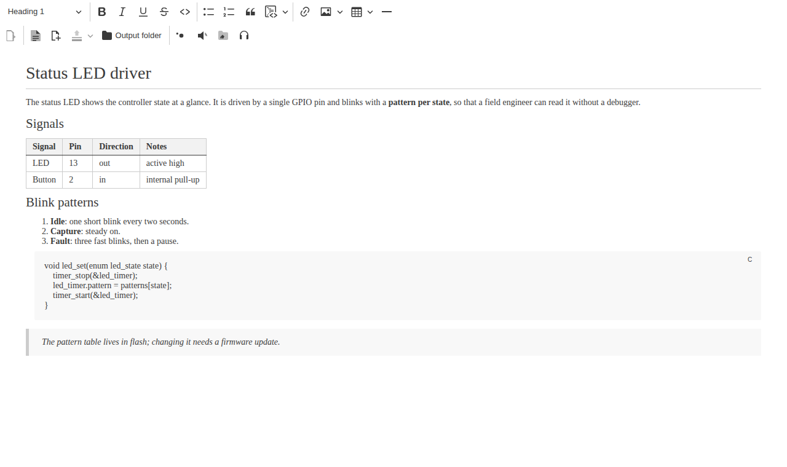
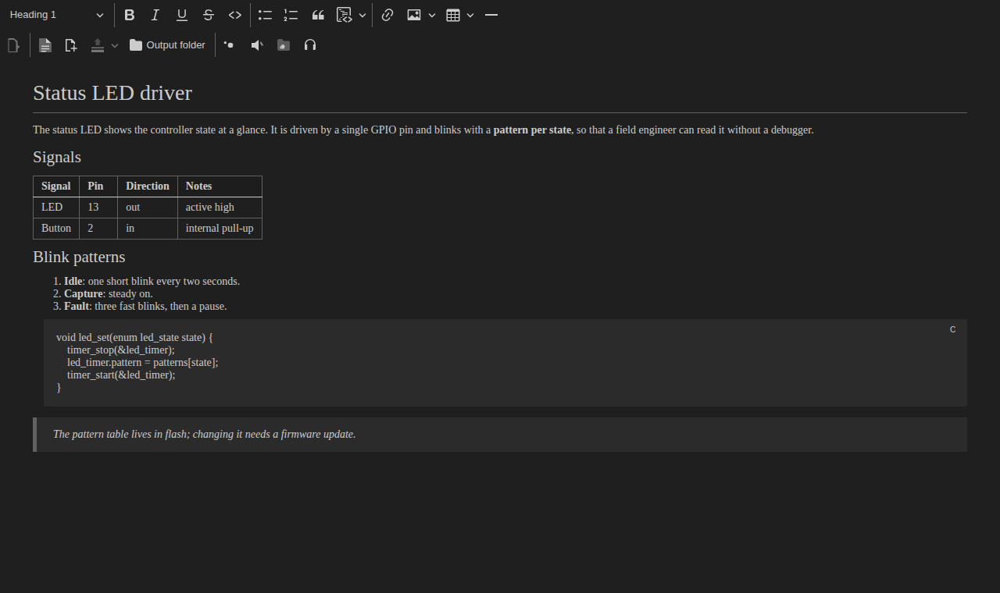

# Edit Markdown visually

In this tutorial you write a short design note with a table, an image and a
code block, switch between the visual and plain-text views, and learn what is
stored in the file.

## Before you start

The WYSIWYG editor is the default editor for `*.md` files. If a Markdown file
opens as plain text, right-click its tab and choose **Reopen Editor With… →
Markdown WYSIWYG Editor**.

## 1. Create the file

1. Create `design-note.md` in your workspace and open it.
2. Type a title and press ++ctrl+1++ (or choose **Heading 1** from the heading
   menu). ++ctrl+2++ to ++ctrl+6++ give the lower heading levels.
3. Write a paragraph. Use ++ctrl+b++ and ++ctrl+i++ for bold and italic, and
   ++ctrl+k++ to insert a link. In lists, ++tab++ and ++shift+tab++ change the
   indent level.

<figure markdown>
  { .screenshot }
  { .screenshot }
  <figcaption>The editor follows your VS Code colour theme.</figcaption>
</figure>

## 2. Add a table

1. Click the table button and drag out three columns by three rows.
2. Type the header row: `Signal`, `Pin`, `Direction`.
3. Click into the cells to fill them in. The table's own toolbar, shown when
   the cursor is in the table, adds and removes rows and columns.

The table is saved as a standard pipe table:

```markdown
| Signal | Pin | Direction |
| --- | --- | --- |
| LED | 13 | out |
```

## 3. Add an image and a code block

1. Paste an image link, or use the image button and enter a relative path such
   as `images/board.png`. The alternative text you enter is kept in the
   Markdown and is read aloud by the [reader](listen_to_a_document.md).
2. Click the code-block button, choose a language (C, C#, C++, CSS, Diff, HTML,
   JavaScript, …) and type or paste code.

## 4. Paste from other applications

Copy formatted text from a browser or a word processor and paste it. Headings,
lists, links and tables are converted to Markdown. To paste without
formatting, use ++ctrl+shift+v++.

## 5. Switch to plain text

Press ++ctrl+shift+e++. The same file opens in VS Code's text editor, where you
can use regular Markdown and every text-editor feature. Press ++ctrl+shift+e++
again to return.

!!! note "One file, two views"
    Both views edit the same `TextDocument`. Undo history, dirty state and
    saving behave as for any VS Code file. See
    [WYSIWYG editor](../theory_of_operation/wysiwyg_editor.md) for how changes travel
    between the two.

## 6. Know the limits

- The editor writes CommonMark/GFM. Constructs it cannot represent visually,
  such as raw HTML blocks, are kept as they are but may not render.
- A bullet list whose items are separated by blank lines can be shown
  differently from how a Markdown renderer shows it.
- Undo history is cleared when the file is saved.

## Next

- [Listen to a document](listen_to_a_document.md): hear what you just wrote.
- [Convert Markdown with Jinja templates](jinja_templates.md): the second
  toolbar row turns this document into other formats.
