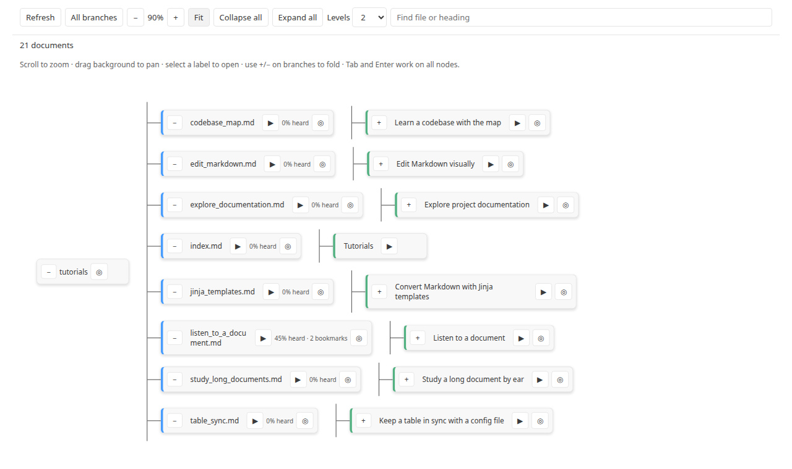
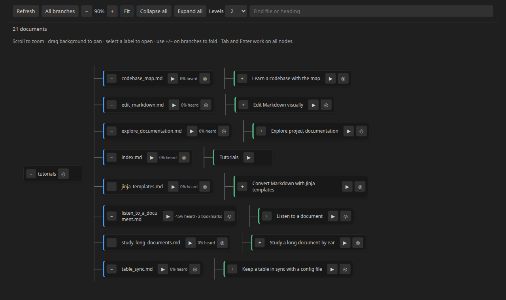

# Explore project documentation

In this tutorial you find your way around a project's documentation with the
documentation tree and mind map, build a listening queue, and let the
extension suggest a guided tour.

## 1. Open the documentation tree

Open a project folder. The **Documentation contents** tree appears in two
places that show the same index:

- the **Documentation and mind map** icon in the Activity Bar, and
- the **Documentation contents** section of the Explorer.

Documents are grouped by workspace folder and folder, and each one expands
into its headings. Click a heading to open its source line. Hover a heading
and click the inline play icon to **Listen from documentation section**.

Every supported format is indexed: Markdown, plain text, HTML, PDF, Word,
OpenDocument, EPUB, RTF, reStructuredText and AsciiDoc. PDFs are listed by
page.

## 2. Open the mind map

Click the mind-map icon in the tree's title bar. Other ways in are the
**Mind map** button in the status bar, the mind-map icon on the editor
toolbar, the **Mind map** button in the reader, and **Markdown Editor: Open
documentation mind map**.

<figure markdown>
  { .screenshot }
  { .screenshot }
  <figcaption>The mind map focused (◎) on one folder: files, their top headings, heard progress and bookmark counts.</figcaption>
</figure>

| To… | Do this |
| --- | --- |
| zoom | scroll, or use the zoom buttons; **Fit** shows everything |
| pan | drag the background |
| show fewer levels | choose a level preset |
| hide a branch | click its collapse control |
| concentrate on one branch | click ◎ on it; **All branches** returns |
| find a document or heading | type in the search box |
| open a section | click its label |
| listen from a section | click its play button |

The map also shows what you have heard: per-file progress, a marker when a
document reached its end, and bookmark counts. Relative links between
documents appear as dashed link nodes. Links to websites are shown but never
fetched.

!!! info "Large projects"
    The map draws at most 3,000 nodes at once and tells you when it has
    truncated. Use search, a lower level preset or ◎ to focus. The tree in
    the sidebar always holds the complete index.

## 3. Build a listening queue

In the reader, open the project workspace section:

1. Click **Add documents**, **Add folder** or **Add project** to fill the
   **Listening queue**.
2. Reorder or remove items as needed.
3. Click **Start / Resume queue**. Each document resumes from its saved
   position, and the next one starts when the current one ends (clear the
   automatic-continuation checkbox for manual control).

**Next document** skips ahead and **Return to previous document** goes back.

## 4. Take a guided tour

Type a topic into **Tour topic**, for example `power management`, and click
**Build guided project tour**. The queue is replaced by a suggested order:

- without a topic: README and overview documents, then architecture and
  design, then setup, then examples;
- with a topic: only documents that mention it (plus README and overview
  documents for context), with the same ordering inside that set.

At most 30 documents are queued.

The tour is a deterministic suggestion you can edit, not a guarantee that
every prerequisite is covered.

## 5. Follow the text while you listen

- **Show synchronized source** opens the source document (or a read-only
  extracted view for PDF, Word and other formats).
- **Follow source text** highlights the current line in a visible text editor
  and scrolls with the reading.
- **Focus mode** hides secondary controls and keeps only the current passage,
  Continue, Pause, Replay and Bookmark visible.

## 6. Improve pronunciation and extraction

**Pronunciation and language** takes a JSON list of whole-word replacements
that are used only for speech:

```json
[
  {"term": "GPIO", "say": "G P I O", "language": "en"},
  {"term": "GPIO", "say": "gé pé í ó", "language": "hu"},
  {"term": "STM32", "say": "S T M thirty two", "language": "en"}
]
```

A rule for a specific language overrides an `any` rule for the same term. Up
to 1,000 rules are kept. **Speech language** can be English, Hungarian,
automatic or the selected voice; automatic detection is a heuristic and can
misjudge short or mixed passages.

**Correct extracted structure** lets you fix a PDF or Word extraction: heading
markers, code fences, table delimiters, reading order, or
`:::reader-header` / `:::reader-footer` regions. Corrections are stored per
workspace and the original file is never changed.

## About the local AI panel

The workspace has an **Ask bundled model** section (Explain, Summarize, Find
stated dependencies, Answer a question). The current build does **not** bundle
the model, so it reports *Bundled local AI is missing*. See
[Listening workspace](../theory_of_operation/listening_workspace.md#local-ai-assistant)
for how it works when a model bundle is present.
