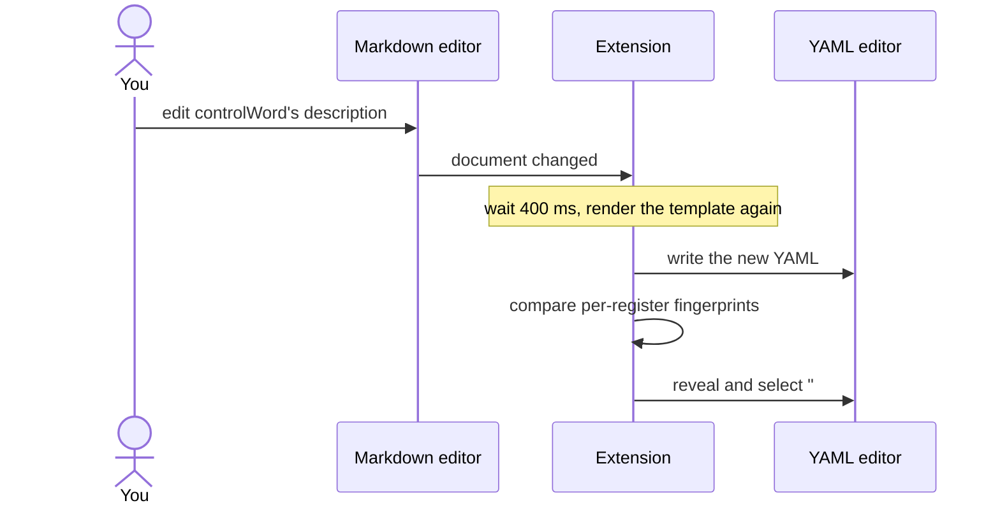

# Convert Markdown with Jinja templates

In this tutorial you convert a register-map document into YAML with a bundled
template, edit the Markdown and watch the YAML follow, edit the YAML and watch
the Markdown follow, and finally create a template of your own from a pair of
examples.

You need the extension's repository (or copies of
`tests/fixtures/register-map-demo.md` and the `templates/` folder).

## 1. Look at the source

Open `tests/fixtures/register-map-demo.md` in the WYSIWYG editor. It is a
register map: one row per register, with offset, size, access flags and a
description that contains a nested field or enum table.

```markdown
| Offset | Word | Name | Size | Format | Access | Description |
|--------|------|------|------|--------|--------|-------------|
| 0 | 0 | deviceId | 4 byte | enum | R | Unique device identifier<br><table>… |
| 4 | 1 | controlWord | 4 byte | bitfield | R/W | Top-level control register<br><table>… |
```

## 2. Pick a template and generate

The second row of the editor toolbar holds the conversion controls:

| Control | Purpose |
| --- | --- |
| **Template** | opens a file browser to choose a `.j2`, `.jinja` or `.jnt` template (or a legacy `.table-template.json` mapping) |
| **Format** | the output format; **Template default** uses the template's own |
| **Output folder** | where generated files go; empty means next to the template |
| **Generate** | renders the template against the open document |
| **Create Jinja template from examples** | infers a new template, see step 5 |

1. Click **Template** and choose `templates/register-map-to-yaml.j2`. The
   button now shows the template's name, *Register map to YAML*, and
   **Format** shows YAML.
2. Click **Generate**.

The YAML file opens beside the editor:

```yaml
# Regenerated from demo_fpga_types.md by register-map-to-yaml.j2
types:
# @register deviceId
  deviceId:
    size: 32
    format: enum
    doc: "Unique device identifier"
    values:
      Unknown: 0
      DemoBoardA: 256
```

To produce another format, choose a different template, such as
`register-map-to-json.j2`, `-toml`, `-xml`, `-csv`, `-tsv`, `-ini`, `-env`,
`-properties` or `-html`.

## 3. Edit the Markdown and watch the output

Change the description of `controlWord` in the Markdown. About half a second
later the YAML is regenerated, and the YAML editor scrolls to the
`controlWord` section and selects it, so you see exactly where your edit
landed.



## 4. Edit the output and watch the Markdown

Now change the `doc:` of a field in the YAML and **save**. The edit flows back
into the Markdown table: register cells and nested field or enum tables are
updated, offsets and the rest of the document are kept.

Some changes belong in the Markdown only: add, remove or rename registers
there, because that is where the offsets are defined.

!!! warning "When both sides changed"
    If the Markdown and the output were both changed since the last
    synchronization, neither is overwritten; the extension reports the
    conflict. Decide which one is right and click **Generate** to make the
    Markdown win, or undo the Markdown change and save the output again.

The link between the two files lasts for the current VS Code window, even if
you close the Markdown tab. After restarting VS Code, click **Generate** again
to re-establish it.

## 5. Create a template from examples

Writing a template by hand is not always necessary. If you have a source file
and the output you expect from it, the extension can infer the template.

1. Click **Create Jinja template from examples** in the toolbar (or run
   **Markdown Editor: Create Jinja Template from Examples**).
2. Choose the source example (Markdown, JSON or YAML).
3. Choose the expected output example.
4. Choose where to save the `.j2` file.

Before it offers to save, the extension renders the inferred template against
your source and checks that the result is exactly your expected output.

The generator finds source values in the expected text. It recognizes
Markdown headings and table cells, and fields in JSON and YAML. Two or more
matching records become a loop. Text with no source match stays literal.

!!! tip "Make the examples informative"
    Use different values in every row, so that columns cannot be confused, and
    try the template on a second example before you rely on it.

Choose **Run Template** in the notification to run it on another source, or
use **Markdown Editor: Run Jinja Template** at any time.

## 6. Convert back

The repository also has backward templates. Open a generated
`*_fpga_types.yaml`, choose `templates/yaml-to-register-map.j2`, set
**Format** to **Markdown** and click **Generate**: the register-map Markdown
document is rebuilt from the YAML.

## Next

- [Jinja template reference](../reference/jinja.md): syntax, context values
  and every helper.
- [Templates and synchronization](../theory_of_operation/templates.md): how rendering,
  the live link and reverse synchronization work.
