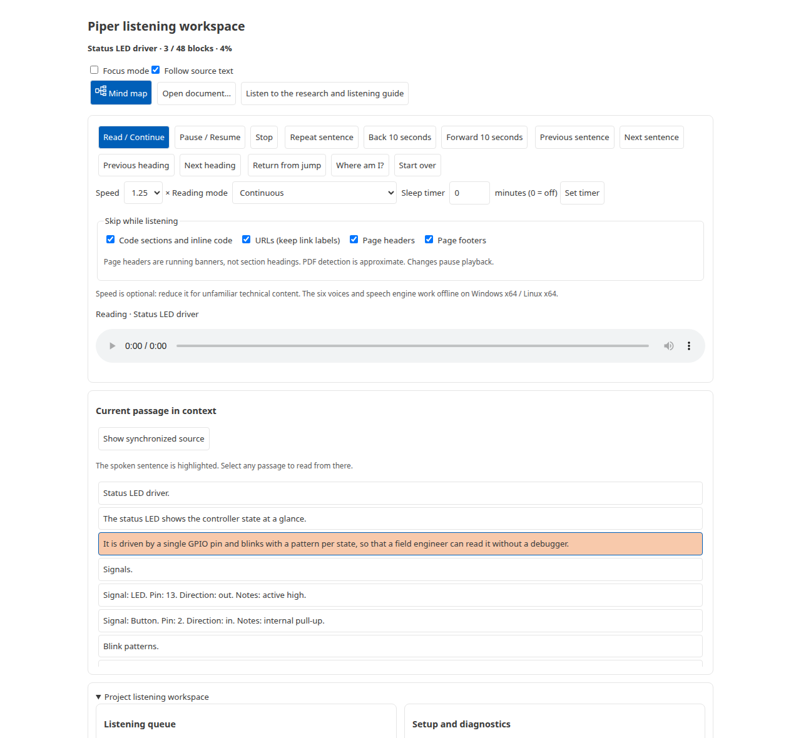
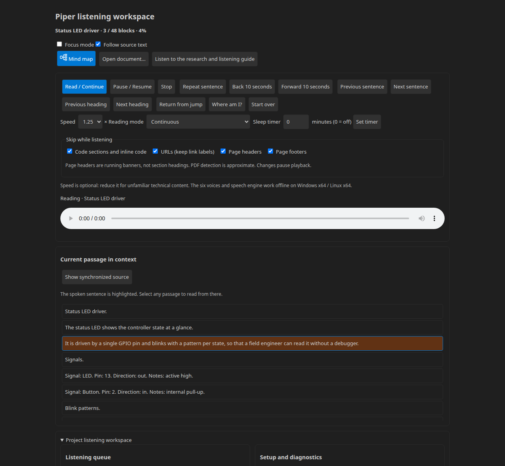

# Listen to a document

In this tutorial you listen to a Markdown file, move around it by sentence and
heading, keep your place with bookmarks, and set up the voice and speed that
suit you.

## 1. Start reading

Open a Markdown file and press ++ctrl+alt+shift+r++, or click the speaker icon
in the editor toolbar. To read only part of a file, select it in the text
editor and run **Read Markdown Selection (Piper)**.

The **Piper listening workspace** opens beside the editor and starts reading
once the voice has loaded. The current sentence is highlighted in the list of
nearby passages; click any passage to continue from there.

<figure markdown>
  { .screenshot }
  { .screenshot }
  <figcaption>The reader: controls, speed and reading mode at the top; the current sentence highlighted among the nearby passages below.</figcaption>
</figure>

!!! tip "First session on a new machine"
    Open **Voices and offline engine** and click **Check bundled engine**. In
    the project workspace section, **Run diagnostics** checks trust, voices,
    the engine and real synthesis, and **Test speaker** plays a sentence. Only
    you can confirm that the sound actually came out of your speakers.

## 2. Navigate

| To… | Click | Keys (reader focused) |
| --- | --- | --- |
| pause or continue | **Pause / Resume** | ++alt+shift+p++ |
| go to the previous or next sentence | **Previous sentence** / **Next sentence** | ++alt+shift+left++ / ++alt+shift+right++ |
| go to the previous or next heading | **Previous heading** / **Next heading** | ++alt+shift+up++ / ++alt+shift+down++ |
| hear the sentence again | **Repeat sentence** | ++alt+shift+r++ |
| skip 10 seconds | **Back 10 seconds** / **Forward 10 seconds** | — |
| find out where you are | **Where am I?** | ++alt+shift+l++ |

**Where am I?** speaks the document name, the heading path, how far through
you are and an estimate of the remaining time, then pauses. Press **Read /
Continue** to go on.

The same actions work while another editor has focus, through VS Code
keybindings such as ++ctrl+alt+right++ (next passage). The full list is in
[Keyboard shortcuts](../reference/keyboard.md).

## 3. Jump and come back

1. Open **Find in document**, type a term and click **Find**.
2. Pick a result and click **Read result**: reading continues there.
3. Click **Return from jump** (++ctrl+alt+shift+backspace++) to go back to
   where you were before the jump.

**Document outline** works the same way: choose a heading and click **Read
from heading**. **Tables, figures, references and pages** lists those
structures separately.

## 4. Bookmark

Press ++alt+shift+b++ (or **Bookmark passage**) at a passage you want to come
back to; a short confirmation is spoken. Later, choose it under **Bookmarks**
and click **Read bookmark**.

Bookmarks and your position are saved per workspace. If the document changes,
they are reset rather than pointing at the wrong text.

## 5. Choose a voice and speed

1. Open **Voices and offline engine**.
2. Choose **Hungarian / Magyar** or **English** under **Language**, or search by
   name.
3. Choose a voice and click **Use / Download voice**.

The six bundled voices (LJSpeech, John, Kristin; Anna, Berta, Imre) work
immediately and offline. Other catalog voices are downloaded on request and
need network access; check **Model license** first, since some catalog voices
have non-commercial licenses.

Set **Speed** between 0.5× and 4×. Pitch is preserved. Choose the fastest rate
at which you can still explain what you heard; there is no benefit in a speed
you cannot follow.

## 6. Decide what is read

Under **Skip while listening**, four independent options are on by default:

- code blocks and inline code
- URL addresses (the link text is still read)
- running page headers
- running page footers

Section headings are never skipped. Changing an option pauses reading and
rebuilds the index near the current line; press **Read / Continue** to go on.

## 7. Listen to other formats

Click **Open document…** to read HTML, PDF, Word (`.docx`), OpenDocument
(`.odt`), EPUB, RTF, reStructuredText, AsciiDoc or plain text. The document is
converted locally into a read-only text view. See
[Document formats](../reference/document-formats.md) for what each format
supports.

## Next

[Study a long document by ear](study-long-documents.md) puts these controls
together into a method for 200-page specifications.
