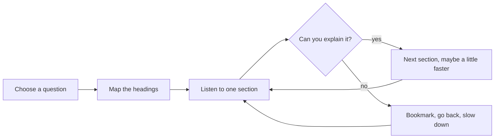

# Study a long document by ear

Listening to a long technical document from start to finish rarely works: you
lose your place, you cannot skim, and you forget what you heard. This tutorial
applies a method based on screen-reader practice and learning research. The
evidence behind each step is summarized in
[Listening research](../about/listening_research.md).

## 1. Choose a question

Before you press play, decide what you need: understanding an architecture,
finding a configuration step, or checking an electrical constraint. A specific
question tells you which sections matter.

## 2. Map the document first

1. Set **Reading mode** to **Headings only** and press **Read / Continue**.
   You hear only the headings: the author's table of contents.
2. When you hear a section that answers your question, stop, choose it in
   **Document outline** and click **Read from heading**. Reading switches to
   continuous mode there.
3. Say in your own words how that section relates to its parent chapter.

The outline is the author's structure, not a generated summary.

## 3. Listen to one coherent section

Use **Continuous** mode and a voice that matches the document's language: an
English datasheet read by a Hungarian voice (or the reverse) is avoidable
friction.

## 4. Recover as soon as you lose the thread

Do not restart the chapter. Instead:

- ++alt+shift+r++ repeats the sentence;
- ++alt+shift+left++ goes back one sentence;
- ++alt+shift+l++ tells you where you are.

## 5. Bookmark questions instead of re-listening

When a passage raises a question you cannot answer now, press
++alt+shift+b++ and continue. Come back to the bookmarks with the surrounding
section in mind.

## 6. Retrieve, not just replay

Set **Reading mode** to **Pause after each paragraph for recall**. After each
paragraph, reading pauses; explain the main point out loud before you
continue. For a driver document, name the input, the state change, the output
and the failure mode. If you cannot, listen to the paragraph again.

This is a study aid. The extension does not hear or score your answer.

## 7. Increase speed only while understanding holds

Raise the speed in small steps, such as 1.0× to 1.1× or 1.25×. Keep the new
speed only if you can still explain each passage. Slow down again for
unfamiliar material.

## 8. Bound the session

Use **Sleep timer** to end a session after a fixed time. Your position and
bookmarks are saved, so the next session starts where this one ended.
