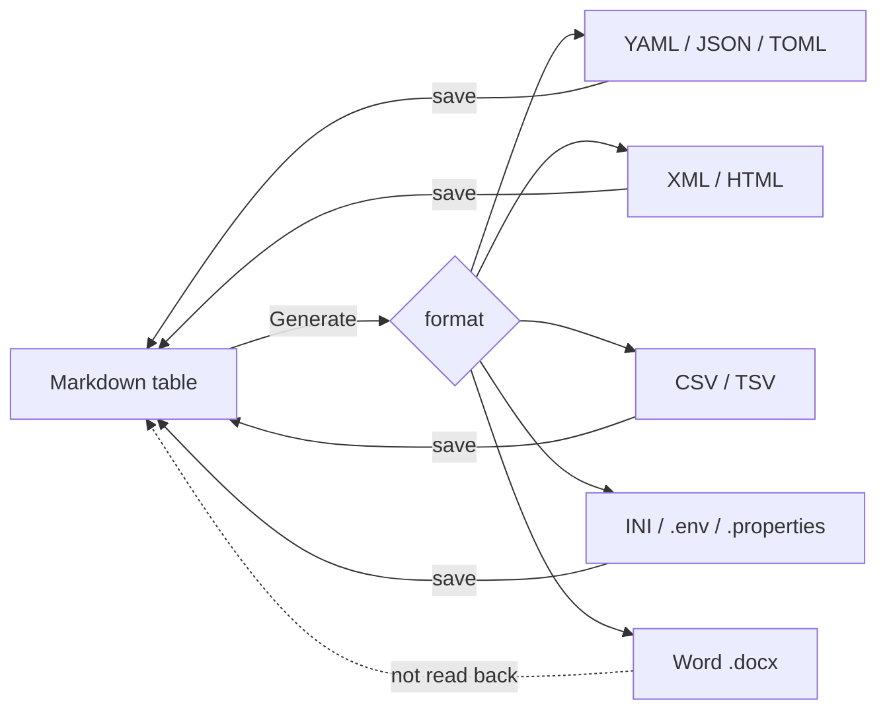

# Keep a table in sync with a config file

A table mapping binds one Markdown table to a structured file such as JSON,
YAML or CSV. Edit the table and generate the file; edit and save the file and
the table follows. In this tutorial you bind a device table to a JSON board
configuration.

Use a table mapping when a document and a configuration file must list the
same items. Use a [Jinja template](jinja_templates.md) when you need to
control the output text freely.

## 1. Mark the table

Create `devices.md`:

```markdown
# Board devices

<!-- table-sync:devices -->
| ID | Name | Pin | Enabled |
| --- | --- | --- | --- |
| led | Status LED | 13 | true |
| btn | User button | 2 | true |
<!-- /table-sync:devices -->
```

The comment markers name the table (`devices`). Everything outside them
(headings, prose, other tables) is never touched by synchronization.

## 2. Write the mapping

Create `devices.table-template.json` next to it:

```json
{
  "version": 1,
  "format": "json",
  "markdown": "devices.md",
  "output": "generated/board.json",
  "table": "devices",
  "root": ["project", "devices"],
  "key": "ID",
  "columns": {
    "ID":      {"path": ["id"], "type": "string"},
    "Name":    {"path": ["name"], "type": "string"},
    "Pin":     {"path": ["hardware", "pin"], "type": "number"},
    "Enabled": {"path": ["enabled"], "type": "boolean"}
  }
}
```

- `root` is where the row list lives in the output: `project.devices`.
- `key` is the column that identifies a row. With a key, rows can be
  reordered, and Markdown-only columns stay attached to the right row.
- `columns` maps each Markdown column to a path inside a row and a type
  (`string`, `number` or `boolean`).
- Paths are relative to the mapping file.

## 3. Generate

Open `devices.md` in the WYSIWYG editor, click **Template**, choose
`devices.table-template.json`, then click **Generate**. The result is
`generated/board.json`:

```json
{
  "project": {
    "devices": [
      {"id": "led", "name": "Status LED", "hardware": {"pin": 13}, "enabled": true},
      {"id": "btn", "name": "User button", "hardware": {"pin": 2}, "enabled": true}
    ]
  }
}
```

The file is shown compactly here; the generated file is indented with tabs.
If a file already existed at that path, it was first copied to
`board.json.table-sync.bak`.

## 4. Edit the JSON

In `board.json`, change the button's pin to `3` and save. The Markdown table
now shows pin `3`; the rest of `devices.md` is unchanged.

Add a `Notes` column to the Markdown table. It is not mapped, so it never
appears in the JSON, but when the JSON is saved, each note stays with its row
(matched by `ID`), even if the rows were reordered.

!!! warning "Generate rewrites the whole output"
    **Generate** writes the output file from the Markdown table alone. Fields
    you add to the output by hand that are not in `columns` (for example a
    `debounceMs` property) are not kept on the next Generate. Map every field
    you want to keep, or keep such settings in a separate file.

Adding or removing a row on either side adds or removes it on the other.
Changing an ID counts as removing one row and adding another.

## 5. Choose another format

Change `"format"` and `"output"` to use another adapter, or override the
format with the toolbar's **Format** menu. All eleven formats are generated;
ten can be read back:



The exact layout each format uses is in
[Table mappings](../reference/table_mapping.md).

## Rules that keep synchronization reliable

- Keep IDs unique and non-empty. Keep identifiers such as `001` as strings.
- Give each output one owner: one mapping, one marked table.
- Deleting the output file does not delete rows. To remove all rows, keep an
  empty list in the output.
- Keep both files under version control. Synchronization is local and is not
  a transaction across applications.
